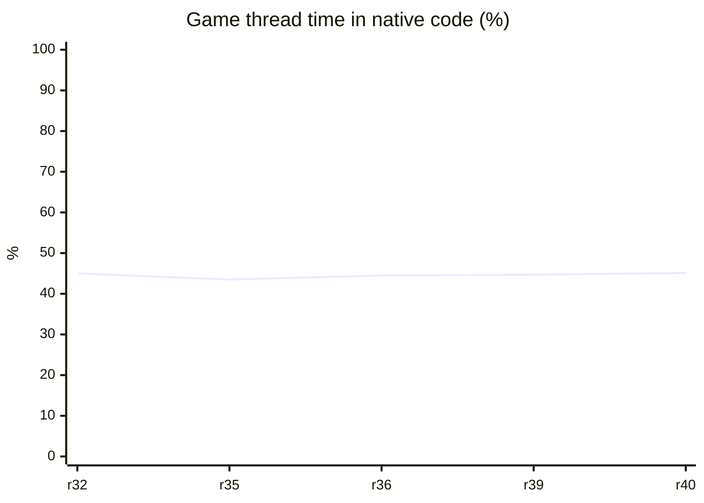

# Celosia

A native port of **Shadow of the Colossus** (PS2, USA, SCUS-97472) to macOS
(Apple Silicon) and the **PS Vita**, built by statically recompiling the
game's MIPS code to C++ with [PS2Recomp](https://github.com/ran-j/PS2Recomp).

No emulator runs the game's CPU code. The EE code from the boot ELF and the
game's three XFF modules is translated into C++ ahead of time and compiled
natively. The game is drawn by a native renderer (Metal on the Mac, OpenGL
ES on the Vita) that reads its model data directly. The rest of the hardware
it talks to (DMA, IOP, SPU2) is reimplemented as host code.

**Progress page: [henrykun55.github.io/celosia](https://henrykun55.github.io/celosia/)** (recompilation, decompilation by area, next targets, rounds). **Where it stands: [docs/STATUS.md](docs/STATUS.md)**.

> **No game data is included.** You need your own copy of the game.

## Status


| Area | State |
| --- | --- |
| Boot, logos, intro cinematic | ✅ |
| Native renderer (models, characters, 2D, fog, bloom, shadows, reflections, water…) | ✅ all 49 tracked features native |
| Audio (SPU2: voices, ADSR, reverb, streaming) | ✅ |
| Title screen, menus | ✅ |
| Memory card (libmc2, PCSX2-compatible `memcards/Mcd001.ps2`) | ✅ |
| New Game, intro, riding Agro, gameplay | ✅ |
| Performance, Mac (M4 Pro) | 60 fps, drawn at 1536×1344 |
| PS Vita | ✅ builds and runs (18–25 fps in Vita3K's intro); fidelity and speed in progress |
| Decompilation | started: software doubles rewritten and proven ([docs/decomp.md](docs/decomp.md)) |

## Requirements

- macOS on Apple Silicon, Xcode Command Line Tools
- `brew install cmake ninja pkg-config ffmpeg python`
- A disc image of **Shadow of the Colossus (USA)** (`SCUS_974.72`), as an
  `.iso` or a `.zip` containing one
- About 10 GB of free disk space and an internet connection for the first build
  (CMake downloads raylib, imgui and sse2neon)

## Quick start

```sh
git clone git@github.com:HenryKun55/celosia.git
cd celosia
./celosia setup --iso "/path/to/Shadow of the Colossus (USA).iso"
./celosia run
```

`setup` takes a while the first time: it compiles the runtime and around 16k
recompiled functions. It briefly opens the game window a few times while it
captures each module (see below).

### Settings

- **F1** (Select twice on the Vita): the player menu. Video, sound,
  language, in Portuguese or English. L1 / R1: tab, up / down: item,
  X or left / right: change, Triangle: help, O or Select: close (the game
  gets no pad input while it is open). Its **Debug** tab (R1 three times)
  changes the developer switches live, without editing `env.txt` or
  rebooting (`env.txt` still sets where they start). Its first rows are
  the **sacrifices** (round 36), each one taking something off the picture
  to save the console's game-thread time, game logic untouched, saved in
  `settings.cfg` (the Vita's default: fewer particles on; the Mac: all off):
  **Fewer particles** ("Partículas reduzidas", `SOTC_SAC_PARTICLES`: every
  emitter makes half as many) and **Coarser model detail** ("Detalhe reduzido",
  `SOTC_SAC_LOD`: detail levels picked as if 1.6x as far; nothing
  disappears; off by default). `SOTC_SACRIFICES=0` turns them all off at
  start. On the Vita the picture is always capped at 30 fps in frames with
  a scene (round 36; not a menu item there; loading screens, logos and
  black frames are not capped, so the loader is never held back;
  `SOTC_CAP30=0` / `SOTC_CAP30_ALWAYS=1` for testing). **Mark this moment**
  writes `[mark] <n> frame <f>` to the log (`err.txt` on the Vita) to find
  a moment later; **Performance overlay** shows fps, the frame's time split
  (game, hooks, render thread, wait, present), the worst frame of the last
  4 s and a frame-time graph with the menu closed (`SOTC_PERF_OVERLAY=1`);
  the frame and sound logs (`SOTC_FRAME_LOG`, `SOTC_FRAME_LOG_ALL`,
  `SOTC_AUDIO_LOG`), the Vita's glow layer (`SOTC_GLOW_VITA`), the bloom's
  frame (`SOTC_BLOOM_SAMEFRAME`), and the renderer's other switches.
  **Record scene** ("Gravar cena"): X once, close the menu, play; a "REC"
  marker shows while everything the native renderer draws is written to
  `ux0:data/celosia/rec/<date_time>/` (`logs/rec/` on the Mac): each
  frame's draw list, effect settings, timing split, the pad and sampled
  guest pcs, and every 10-60 frames the whole frame (matrices, states,
  vertices, palettes, textures), through cutscenes and area changes. X
  again stops it (or 15 min / 700 MB / a nearly full card).
  `tools/rec.py` lists a recording, prints a frame's draws, exports its
  textures and draws its full captures again with this build's renderer
  to PNG (whole, without the glow composite, layer by layer); see
  [docs/decomp.md](docs/decomp.md), round 25.
- **F10** (Mac): the native renderer's panel. Resolution (× 512×448), bloom
  strength, fog amount and every effect on/off, changed live. "Print to log"
  gives the setting as `SOTC_*` variables that set it at start. The table is
  in [docs/STATUS.md](docs/STATUS.md#settings).
- **F9** (Mac): flips the picture shown between the native renderer's and the
  emulated GS one of the same moment (a "NATIVE" / "GS (emulated)" label shows
  for two seconds). With `SOTC_NATIVE=2` both are drawn every frame, so the
  flip is instant (it starts on the GS picture); with the default
  `SOTC_NATIVE=1` the GS starts drawing again when its picture is asked for
  (a few frames). Round 37: in the host loop, so it works without the
  debugger's build too.
- **F8** (Mac): saves the same moment twice to `shots/` (the folder the game
  runs in): `f8_<n>_emulated.png` (the GS picture, drawn for those few frames
  whatever F9 shows), `f8_<n>_native.png` and `f8_<n>_draws.txt` (the native
  draws of that frame). Works in both `SOTC_NATIVE=1` and `=2`.
- **F12**: the developer debugger (CPU, threads, DMA, memory).

### Controls

A gamepad works out of the box. Keyboard:

| Keys | PS2 |
| --- | --- |
| W A S D | left stick |
| arrows | D-pad |
| H / J | ✕ / ○ |
| Y / U | □ / △ |
| I / O | L1 / L2 |
| K / L | R1 / R2 |
| Z / X | Start / Select |

## How it works

Shadow of the Colossus ships one small boot ELF and loads the rest of its code
at run time: `KERNEL.XFF`, `MANAGER.XFF` and `GAMECORE.XFF`. These are
relocatable modules that the game links in memory with its own dynamic linker.
A static recompiler needs all of that code up front, so `setup` bootstraps it
in stages:

1. **Boot ELF.** Function boundaries are recovered with `tools/funcmap_elf.py`.
   Symbol names come from `KERNEL.XFF`'s imports. The ELF is recompiled with
   `game/scus.toml`.
2. **Module capture.** The game runs until it jumps into code that is not
   recompiled yet, which is the next module's entry point. Guest RAM is saved
   at that moment (`PS2X_DUMP_RAM_ON_MISSING`). The loaded module (sections at
   their final addresses, symbols resolved) is cut out of the dump.
   `tools/modimage.py` locates the module header automatically.
3. **Link.** `tools/build_elf.py` merges the boot ELF and every captured module
   into one `SOTC.elf`, with a function map and the list of instructions the
   guest linker rewrites (`dynamic_imm.txt`). The recompiler decodes those
   instructions from memory at run time. `tools/gen_config.py` writes the
   recompiler config.
4. Steps 2 and 3 repeat for KERNEL → MANAGER → GAMECORE.
5. **VU1.** A scripted run records every VU1 microcode image the game uploads.
   Each image is compiled to C++ (`./celosia vu1`). New images seen while
   playing are saved automatically, and `./celosia vu1` picks them up.

Everything generated (recompiled code, captures, build files) goes to
`build/`. None of it is committed.

## PS Vita

```sh
export VITASDK=~/vitasdk
./celosia vita          # after ./celosia setup: build/vita/ps2xRuntime/ps2EntryRunner.vpk
```

The first run also builds vitaGL at a pinned revision with this port's
patches. Install the `.vpk` (VitaShell, or File › Install in Vita3K). Then
put the extracted disc in `ux0:data/celosia/disc/`. Saves go to
`ux0:data/celosia/memcards/` and logs to `ux0:data/celosia/log.txt` and
`err.txt`. The Vita has no environment: `ux0:data/celosia/env.txt` takes
`NAME=value` lines (for example `PS2X_PROFILE=ux0:data/celosia/prof.txt`).

## Decompilation

The recompiled code works but is not readable. Functions that matter are
being rewritten by hand in C++ and proven equal to the recompiled ones, byte
for byte, on the same machine state (`SOTC_DIFFTEST`). It is a functional
decomp, not a matching one. The workflow (guest profiler, Ghidra scripts,
difftest) is in [docs/decomp.md](docs/decomp.md).

Progress (2026-10-30, round 35; code and call figures from round 28's count):
**5.4%** of the MIPS code (450 of 9,024 functions, the SDK / libc pieces the
runtime implements included; 3.2% of the game's own code), but **48%** of the
guest calls already land in native code (call counts of the attract demo and
the route to frame 4 800): the rewrites go after the hottest functions first.
By time, **43%** of the Vita game thread's instructions run in native code,
**39%** still in recompiled MIPS and 18% in the runtime (DMA walk, memcpy,
scheduler, the glue that calls guest code), from a Vita3K profile of the route
(180-300 s). The recompiled share is spread thin (its biggest function is
1.5%), so it shrinks by rewriting whole subsystems, not single hot spots.
`tools/decomp_tree.py` splits both figures by area of the game
([docs/decomp_tree.json](docs/decomp_tree.json)). Every native function is
listed in [docs/decomp_status.json](docs/decomp_status.json)
(`tools/decomp_status.py` recounts it); the history is in
[docs/decomp_history.json](docs/decomp_history.json) (`tools/decomp_history.py
--add --label rNN [--profile LATE EARLY ELF THREAD]` appends a measurement;
`tools/decomp_tree.py --readme` rewrites the tables below).

<!-- decomp:start (tools/decomp_tree.py --readme writes this block) -->

**Game thread time on the Vita** (r40, Vita3K profile of the route):

| | share | |
|---|---:|---|
| Native code | 45.1% | `█████████░░░░░░░░░░░` |
| Recompiled MIPS | 38.3% | `████████░░░░░░░░░░░░` |
| Runtime (DMA walk, memory, scheduler, glue) | 16.6% | `███░░░░░░░░░░░░░░░░░` |

<details open>
<summary><b>By area of the game</b>: what is native and what still runs as recompiled MIPS</summary>

| Area | Code native | | Functions | Game thread time: native / MIPS |
|---|---:|---|---:|---|
| Display and models | 8.8% | `█░░░░░░░░░░░` | 38 / 978 | 17.3% / 4.8% |
| Characters and motion | 4.8% | `█░░░░░░░░░░░` | 27 / 1212 | 11.5% / 7.6% |
| Other game code (names not identified yet) | 1.5% | `░░░░░░░░░░░░` | 13 / 2877 | 1.9% / 16.7% |
| Collision and physics | 20.7% | `██░░░░░░░░░░` | 47 / 344 | 11.2% / 1.2% |
| Boot ELF, SDK and libc | 14.6% | `██░░░░░░░░░░` | 320 / 2122 | 0.0% / 4.6% |
| System and memory | 5.0% | `█░░░░░░░░░░░` | 4 / 229 | 1.5% / 0.5% |
| Math | 17.1% | `██░░░░░░░░░░` | 21 / 131 | 0.5% / 1.1% |
| Script and events | 0.0% | `░░░░░░░░░░░░` | 0 / 632 | 0.8% / 0.7% |
| Particles and effects | 22.6% | `███░░░░░░░░░` | 6 / 116 | 0.4% / 0.6% |
| Camera | 0.0% | `░░░░░░░░░░░░` | 0 / 281 | 0.0% / 0.4% |
| Sound | 0.0% | `░░░░░░░░░░░░` | 0 / 102 | 0.0% / 0.1% |
| Runtime (DMA walk, memory, scheduler) | | | | 16.6% (runtime) |

</details>

<details>
<summary><b>History</b></summary>

| Measured | Commit | Code native | Calls native | Game thread time native |
|---|---|---:|---:|---:|
| 2026-10-23 | ed10257 | 4.24% | 34.1% |  |
| 2026-10-23 | fce6b0c | 4.31% | 39.6% |  |
| 2026-10-23 | e51649c | 4.51% | 40.3% |  |
| 2026-10-24 | 33afe16 | 4.65% | 40.6% |  |
| 2026-10-25 | d44f871 | 4.69% | 40.9% |  |
| 2026-10-25 | 23595fb | 4.73% | 41.6% |  |
| 2026-10-26 | a7829ef | 5.25% | 51.4% |  |
| 2026-10-27 | bb0bfd8 | 5.25% | 47.5% |  |
| 2026-10-27 | d2d8bb1 | 5.30% | 47.7% |  |
| 2026-10-27 | 3dfcd50 | 5.40% | 47.8% |  |
| 2026-10-29 | a61cb0d | 5.41% | 47.9% |  |
| 2026-10-29 | r32 | 5.41% | 47.9% | 45.0% |
| 2026-10-30 | r35 | 5.41% | 47.9% | 43.5% |
| 2026-10-30 | r36 | 5.41% | 47.9% | 44.5% |
| 2026-10-30 | r39 | 5.59% | 49.0% | 44.7% |
| 2026-10-30 | r40 | 5.73% | 49.1% | 45.1% |

</details>



<!-- decomp:end -->

## Commands

```
./celosia setup [--iso PATH]   full pipeline (extract → capture → recompile → build)
./celosia run                  play (log: logs/play.log)
./celosia vu1                  compile newly seen VU1 microcode and rebuild
./celosia recompile            relink modules, recompile and rebuild
./celosia build                rebuild after editing PS2Recomp sources
./celosia autotest [s] [int]   scripted run, screenshots every int s in shots/run
./celosia vita                 build the PS Vita VPK
./celosia clean                delete build/
```

| Setting | Default | Meaning |
| --- | --- | --- |
| `CELOSIA_DISC` | `./disc` | extracted disc |
| `CELOSIA_BUILD` | `./build` | build and generated code |
| `CELOSIA_JOBS` | CPU count | parallel compile jobs |
| `CELOSIA_CMAKE_ARGS` | | extra CMake configure arguments |

### Runtime switches (debugging)

| Variable | Effect |
| --- | --- |
| `PS2X_INPUT_SCRIPT="11:DOWN:0.3;12:CROSS:0.3"` | scripted button presses (second:button:duration) |
| `PS2X_SNAPSHOT_DIR` / `PS2X_SNAPSHOT_SECONDS` | periodic screenshots |
| `PS2X_STATS=1` | frame, VU1 and GS statistics |
| `PS2X_GS_BOB=1` | bob deinterlacing instead of weave |
| `PS2X_GS_THREADS=n` | raster threads |
| `SOTC_NATIVE=1` / `2` | native renderer shown (default) / drawn but not shown, for side-by-side checks |
| `SOTC_NATIVE_GL=1` / `check` | the OpenGL renderer on the Mac / compared against Metal |
| `PS2X_GS_GPU=0` | emulated view rasterized on the CPU (exact GS fog: the reference for fidelity checks) |
| `PS2X_MTVU=0` | run VIF1/VU1/GIF on the game thread instead of their own thread |
| `PS2X_GIF_THREAD=0` | process GIF packets on the VU1 thread instead of their own |
| `PS2X_GS_PROFILE=1` | where GS raster time goes, and what flushes the draw queue |
| `PS2X_VU1_NOREC=1` / `PS2X_VU1_REC_VERIFY=1` | interpret VU1 / cross-check the recompiled VU1 against the interpreter |
| `PS2X_WATCH_WRITE=start:end` | log guest stores to an address range |
| `PS2X_DUMP_RAM_AT_SECONDS=n` + `PS2X_DUMP_RAM_PATH` | save guest RAM |
| `SOTC_EE_TRUST=1` (Debug "Plain floats") | Vita: the lean hot code's second copy with plain floats (no PS2 operand clamps or adder alignment; ~3% faster, not exact, off by default); `SOTC_EE_TRUST_AB=n` alternates every n frames |
| `SOTC_SKELETON_FAST=0` / `SOTC_SKELETON_FAST_AB=n` | the skeleton pose's round 25 path instead of the register-local one (exact either way) |
| `PS2X_DMA_WALK2=0` | the VIF1 chain walk's round 30 loop and walker (default: round 31's, main RAM tags without the address translation, the walker's state in locals; exact either way) |
| `PS2X_DMA_CACHE=1` | the VIF1 chain's packet cache: a CALL target's packet walked before whose bytes are unchanged has its effect replayed (exact; off by default: slower than walking it in Vita3K) |
| `SOTC_DMACACHE_CHECK=1` (with `PS2X_DMA_CACHE=1`) | each VIF1 chain walked first without the packet cache on copies, then for real, and the VIF1 registers, GS events, MSKPATH3 calls and the channel's registers compared (`[dmacache]` lines) |
| `PS2X_DMA_STATS=1` | the chain walk's counts every 600 chains (`[dmastats]`: tags, CALLs looked up, replayed, walked) |
| `SOTC_GSREG_ASYNC=0` | the 2D functions' GS writes (fades, cinema bars, menus) wait for the model jobs at every write (default: an untextured batch goes to the worker after them, as glEnd's since round 28; same draws, same order) |
| `SOTC_2D_TEX_ASYNC=0` | a textured 2D batch (glEnd's, the 2D functions') waits for the model jobs (default, round 32: it goes to the worker after them too and looks its texture up there, as the cloth's and particles' jobs do; same draws, same order) |
| `SOTC_ZFOG_JOIN=1` | zFog waits for the model jobs, as before round 32 (default: no wait; its host part is the game thread's alone) |
| `SOTC_HOOK_LEAN=0` | modelDisp's hook as in round 31 (default: the part tree walked once, the palette read straight into the job, matrices and lights as block copies, the next draw's matrix / palette / plan asked for and the prefetch queue pumped during the draw; exact) |
| `SOTC_HOOK_LEAN_CHECK=1` / `SOTC_HOOK_LEAN_STATS=1` | both hook paths each draw and their jobs compared / the hook's work counted (`[hook-lean]` every 600 frames) |
| `SOTC_HOOK_ORDER_CHECK=1` | counts game-thread draws made while model jobs were pending (out of the order the worker keeps) |
| `SOTC_HOOK_WORKER_DELAY_US=n` | testing: each model job held n us (a slow worker, as the console's, for the checks above) |
| `SOTC_REC_SAMPLER_PRIO=n` | Vita: the scene recorder's pc sampler's thread priority (default 96, above the worker / render / build threads; 0: as before round 32, when its samples fell where cores 1-2 went idle) |

| `SOTC_LOG_ASYNC=0` / `=1` | the frame, sound and loader logs written at once (`0`, the Mac's default) or through a 512 KB RAM ring that a writer thread on cores 1-2 empties into `err.txt` every ~50 ms (`1`, the Vita's default, round 33: the console's per-line `err.txt` writes cost the game thread ~5 ms a frame); a line that does not fit is dropped and counted (`[log] n lines dropped`), never waited for; other stderr lines stay synchronous and can come out ahead of buffered ones (round 34 on the Vita: they go through the ring too, `SOTC_LOG_STDERR`) |
| `SOTC_THREADS=0` | Vita: round 32's thread layout (default `1`, round 33: the game thread alone on core 0; the model jobs' worker on cores 1-2 above the render thread's and the builds' priority; the sound callback, main thread and disc readers moved to cores 1-2; render thread core 2, builds and recorder cores 1-2 as before). `[threads]` lines say where each thread runs |
| `SOTC_HOOK_WORKER_PRIO=n` | Vita, `SOTC_THREADS=1`: the model jobs' worker's priority (default 150; 64 is the highest, the threads it shares cores with have the default) |
| `SOTC_HOOK_SEMA=0` | Vita: the idle model-job worker sleeps on the condition variable with a 1 ms re-check, as before (default, round 33: a kernel semaphore, one signal a hand-over, no timed re-checks) |
| `SOTC_GL_PRESSURE_POOLS=0` | Vita: under heap pressure (not critical) evict every mesh / texture unused for 8 s, as before (default, round 33: while vitaGL's pools have room only textures that live in the newlib heap go; the others free no heap and were rebuilt and uploaded again, the console's hitches; `kept in pools n` in `[gl:mem]`) |
| `SOTC_KICK_DEFER=0` | the model jobs joined at each display list's kick and its skinned pass made there on the game thread, as before (default, round 34: the bone palettes its hooks saw are copied at the kick and the pass is a worker job behind the frame's model jobs, joined at the next frame's first hook; each model job takes its instance chain, the mip K scale `*0x118c180` and its plan's texture scroll rows at the hook, the things the game changes for the next frame; a frame with a draw without a plan joins at the kick as before; `[skin-kick]` with `SOTC_SKIN_KICK_LOG=1` counts both) |
| `SOTC_KICK_DEFER_CHECK=1` | Mac, checking `SOTC_KICK_DEFER`: the worker is held from each kick to the next join and the held jobs run on a copy of guest memory taken at the kick (protected, so every page they read is marked); each page read is compared with guest memory at the join (`[kick-check]`); a build with `-DSOTC_READ_TRACK` (r34/rt) also marks every guest word the jobs read and names its reader |
| `SOTC_LOG_STDERR=0` | Vita: other stderr lines written at once, as before (default with `SOTC_LOG_ASYNC`, round 34: every stderr write goes into the log ring from the game thread's start on, the writer thread alone writing `err.txt`; the game thread's `[irq] dispatch` lines, seven card writes each, came right before 62 of the 63 in-game frames over 120 ms of round 32's console session) |
| `SOTC_GL_POOL_COMPACT=0` | the renderer's mesh pools (2.3 MB of vitaGL memory each) let go only when empty, as before (default, round 34: every 30 frames the emptiest pool under half full is emptied into the others' free room, 16 K vertices a frame, its run copies dropped, then let go; `mesh pools ... emptied n, MB moved` in `[gl:mem]`) |
| `SOTC_VGL_POOLS=console` | Vita3K testing: vitaGL's pools sized as on a console (CDRAM 96 MB, main RAM 16 MB, phycont 26 MB) instead of from Vita3K's larger free memory; `[vita:mem]` counts what each pool holds and the GPU objects vitaGL put in the newlib heap (`celosia.patch`, round 34) |
| `SOTC_VGL_CIRCULAR_KB=n`, `SOTC_VGL_IMMEDIATE_KB=n` | Vita: vitaGL's circular pool (client-array vertices, the immediate-mode pool; a third a frame in flight) and immediate-mode (glBegin) pool sizes; `32768` / `4096` as before (default, round 35: `3072` / `64`: the port used 4 097 KB a frame at most, 4 096 of it the immediate pool it never draws with; a frame that needs more takes it from the pools, counted in `[vgl:dump]`): 29 MB of vitaGL's main-RAM and phycont pools back |
| `SOTC_GL_SCRATCH_DEPTH=0` | Vita: every render target gets a depth buffer of its own, as before (default, round 35: the targets made without depth, which no draw tests depth or stencil on, share one scratch depth buffer per size, `vglFramebufferScratchDepth`; `[vgl:dump]` counts draws with a depth / stencil test on one, which stays 0): ~1 MB of CDRAM per target at 512 x 448 |
| `SOTC_GL_SHADOWMASK_VITA=1` | Vita: the shadow mask target made and cleared each frame, as before (default, round 35: not made; the Vita's shadow pass returns before drawing it) |
| `SOTC_VGL_MEMDUMP=<s>` | Vita: every s seconds `[vgl:dump]` lines: what vitaGL's pools hold by the code that asked for it (sites resolve against the ELF; "dump base" is `vglCeloMemDump`'s address), the circular / immediate pools' peaks, render targets and their driver memory, scratch depths, and each framebuffer's depth (own / scratch / shared); `[native:gl] targets:` names the renderer's framebuffers |
| `SOTC_PLAN_STATS=1` | also counts the jobs' plan walk (`[plan] ... jobs' walk`: packets looked at, left out by the part / surface test, part runs) |
| `SOTC_SACRIFICES=0` | round 36: every sacrifice off at start (each one's own variable below still wins; saved `sac_*` values in `settings.cfg` are ignored while it is set) |
| `SOTC_SAC_PARTICLES=0/1` | Debug "Fewer particles" ("Partículas reduzidas"): each particle emitter's rate halved (the carried fraction keeps the average; an emitter's first frame still makes one) and at most half its live particles (rounded up); the Vita's default 1 |
| `SOTC_SAC_LOD=0/1` | Debug "Coarser model detail" ("Detalhe reduzido"): modelClipSolid picks the level as if the model were 1.6x as far, only for LOD records that keep their last level past their range (+0x28 clear: nothing vanishes sooner, terrain included); off by default (no game-thread saving measured on the route) |
| `SOTC_SAC_AB=<mask>` | measuring: the sacrifices in the mask (1 particles, 4 detail) on for two 60-frame frame-log windows, off for the next two, and so on, with a `[sac-ab] on/off` line after each window's (`build/agent-scratch/r36/abwin.py` pairs them): one run, the same places |
| `SOTC_CAP30=0`, `SOTC_CAP30_ALWAYS=1` | the Vita: the 30 fps cap off / on in every frame (round 36: always on there, not a menu item, a saved `cap30=0` is ignored; it applies while the native renderer's last frame had 150 draws or more and stops under 40: loading screens, logos and black frames run uncapped, `[cap30] on/off` lines say when it switches) |
| `SOTC_GL_PRESSURE_POOLFREE=1` | Vita: round 33's rule for the heap-pressure eviction (spare what lives in vitaGL's pools only while 8 MB of CDRAM and 2 MB of its main-RAM pool are free). Default (round 36): spared whatever the pools' room: the console's RAM pool sits at 8.2 of ~10 MB, so round 33's spare never applied there and every mesh unused for 8 s went every 16 frames, which gave the heap nothing back and brought the walls of a canyon back as holes |
| `SOTC_ASYNC_BUDGET=n` | builds queued on the worker a frame at most (round 36: 500 by default on the Vita, 0 = no limit elsewhere); past it a draw is left out as one still on the worker and queued later |
| `SOTC_TAKEUP_MS=x` | the finished builds taken up at a frame's start for at most x ms, the rest at the next frames in order (round 36: 8 on the Vita, 0 = all at once elsewhere) |
| `SOTC_GL_RUN_EVICT_OLD=1` | the merged-run copies' room made as before round 36 (a scan and sort of every copy for each copy past the budget, again every frame for a run that found none); default: one scan a frame at most, freeing down to 7/8 of the budget |
| `SOTC_CPU_LOG=1` | Mac: `[cpu]` lines every 60 frames with the game thread's CPU time (clock_gettime(CLOCK_THREAD_CPUTIME_ID)) |
| `SOTC_BODY_SHADOWS=0/1` | Renderer "Body shadows" ("Sombras dos corpos", round 37): Wander's, Agro's and the colossi's own shadows on the ground (the skinned shadow volumes; off: only the sword's, as before). On by default on the Mac and, since round 38, on the Vita too (a settings file older than `settings_version=38` has its `body_shadows` ignored once). Round 38: the volumes' shared inner sides are dropped (Wander 6 888 -> ~3 200 vertices, the shrine figures 24 432 -> ~9 850; `SOTC_SHADOW_ALLSIDES=1`: every side, as before), and the Vita's picture framebuffer now has a stencil buffer (without it the console drew no shadow at all; `SOTC_GL_NO_STENCIL=1`: as before). The console log has a `[shadow]` line every 300 frames (volumes and darkening passes a second) |
| `SOTC_ALPHA_TEST=0/1` | Renderer "GS alpha test" ("Teste de alfa do GS", round 38, on by default): the models' GS TEST (GEQUAL 0x40, AFAIL FB_ONLY) per draw: pixels under half alpha (hair and mane cards' edges, a model fading in) draw their colour without writing depth, so they never hide what is drawn after them (a second pass of the draw with the depth read only, only when the texture's and mesh's least alpha say a pixel can be under) |
| `SOTC_BG_DEPTH=0/1` | (round 38, on) layer 1 (the sky and the far landscape) drawn with the depth test into the background image, as the GS draws it into the frame before `bgEnd`'s copy: without it the far trees and the cliffs' far faces were drawn over the near cliffs in draw order (grey blocks and pale angular shapes instead of the mountains on the horizon) |
| `SOTC_FOG_AMOUNT=x` | the vertex fog's share; 1 (the game's own) by default since round 37 (it was 0.55, set by eye against an emulated picture that had no GS fog). A `settings.cfg` / `celosia_settings.cfg` from before round 37 (`settings_version` < 37) has its `fog_amount` ignored once |
| `SOTC_AB_FLAG=<names>`, `SOTC_AB_PERIOD=n` | fidelity A/B (round 37): the named renderer switches (`bloom vfog zfog glow dof shadows sblur feedback ptcl reflect refract subtract additive overlays sky`, round 38: `alphatest bgdepth bodyshadows allsides lighting`, and `L<n>` for display list layer n hidden) off in every other window of n frames (30 by default), so the pairs of one `SOTC_NATIVE=2` run compare the native picture with and without them against the same GS pictures (`build/agent-scratch/r37/ab.py`); `,` or `:` between names |
| `SOTC_SHADOW_LOG=1` | every 60 frames, each shadow volume drawn (`[shadow]`: chain, model, skinned; `[shadowvol]`: extrusion and vertex count) |
| `PS2X_PMODE_LOG=1` | the emulated display's PMODE / DISPFB / DISPLAY registers now and then (`[pmode]`; SotC: 0x8023, both read circuits on the same frame one line apart, blended 50/50) |
| `PS2X_TEST_LOG=1` | (round 38) the emulated GS's primitives counted by context state (TEST, ALPHA, TEX0 PSM / TCC, FBA), printed every 2^20 primitives (`[test]`; `build/agent-scratch/r38/testlog.py` decodes the last dump) |
| `SOTC_LOG_HEADER=<hex>` | (round 38) every 30 frames, each surface of that model as drawn (`[header]`: texture mode, posed, lit, blend, layer, ALPHA_2) |
| `SOTC_CAMCOLL=0` | (round 39) the camera's collision path and the collision filters made native this round back to the recompiled code: `camera_collision_check_direct` / `camera_invisible_collision_check_direct_by_exception_obj`, `GetArbitraryDirectionInverseMatrix` with `iosGetArbitraryUpVectorElement`, `GetQuaternionByAxisDirZYExact` and `iosAbsVector`, the object filters (`CollisionObjectJudgeCallbackExcept(Descend)PluralObj`, `gamecore_sub_0140FAB8` / `01434FC0` / `013D54F0`), the id filters (`CollisionPlaneJudgeCallbackCameraMove`, `playerPlaneJudgeFuncCameraFilter`, `gamecore_sub_01395830` / `013958B8` / `01444800`, `manager_sub_0110C790`), `EntryModifiedManager` and the uncached case of the vertex fetcher `0x1114c70`; each one's table entry alone with `SOTC_DECOMP_SKIP=<name>` (the names in `game/overrides/decomp_collision.cpp` / `decomp_quat.cpp`; the native collision code's own calls of the filters, the vertex fetcher and EntryModifiedManager follow `SOTC_CAMCOLL` only) |
| `SOTC_COLLPROBE=0` | (round 40) the collision natives of round 40 back to the recompiled code: the scripts' collision callback `SCRGetCollisionCallBack`, the id filters `moveCtrlWallJudgeFunc` (the plane's slope in degrees), `gamecore_sub_013CB8E8` and `AI_JudgeColAttrFunc`, `GetCollisionDBPlane` and the water probes `manager_sub_01117EA0` / `manager_sub_01117340`; each one's table entry alone with `SOTC_DECOMP_SKIP=<name>` (the native collision code's own calls of the filters follow `SOTC_COLLPROBE` only) |
| `SOTC_DIFFTEST_MAX=<n>` | (round 40, checking) after each n checks of a function past `SOTC_DIFFTEST_FIRST` its stride (`SOTC_DIFFTEST_EVERY`) doubles; default 1000 with `SOTC_DIFFTEST=all`, off for a list of names. `all` now checks every registered native (512 slots, was the first 64) |

With `SOTC_FRAME_LOG=1` the `[frame]` lines also end in `| sync ... | joins ...`: the game
thread's work at the frame's change by part (the join, endFrame, the frame log, the sound log,
the idle thread's turn, the rest) and the model-job joins by site (round 32). Round 33 adds
`lag <us> max <ms>` (a job's wait from its hand-over until the worker takes it up: average,
largest) and, on the console, `| cpu <thread> <ms> (<n>p <n>m), ...`: each thread kind's CPU
time, preemptions and moves to another core (from the kernel's run clocks; Vita3K has none,
so the column is left out there). Round 36 adds to the slow-frame lines `cd ... (n reads, KB, game x)` (the disc read time
that was the game thread's own) and `render x (lock, up, draw, sweep, runs copied / scans)` (the render thread's time by part:
the GL lock's wait, uploads applied, the draws, the cache sweep, and the merged runs copied and room scans).

Recompile-time and build-time switches for the generated code (round 29;
each gives the same results, they only bring back the older, slower form):

| Switch | Effect |
| --- | --- |
| `PS2X_RECOMP_VUKNOWN=0` (recompiler env) | VU0 add / sub / mul normalise every operand again (default: not the ones already normalised by an earlier VU0 op in the same straight-line run) |
| `PS2X_RECOMP_FPUKNOWN=0` (recompiler env) | FPU add / sub / mul clamp every result again (default: not when both operands are known finite) |
| `PS2X_RECOMP_REGCACHE_DSE=0` (recompiler env) | every register write stored to the context at once (default: no store for a write that a later statement of the same run overwrites) |
| `-DPS2X_FPU_ALIGN_FAST=0` (C++ flags) | the PS2 adder's operand alignment on every FPU add (default: only when the magnitudes subtract) |
| `PS2X_RECOMP_LOOP_PC=0` (recompiler env) | a loop's back edge stores `ctx->pc` before its checkpoint test (default: only when the checkpoint is taken, `PS2_CHECKPOINT_DUE_AT`) |
| `PS2X_RECOMP_FLOAT_JOIN=0` (recompiler env) | the VU0 / FPU provenance forgotten at every label and branch (default: kept across forward branches, and at labels whose gotos all come before them, what the edges agree on) |
| `PS2X_RECOMP_VU_LOADS=0` (recompiler env) | every guest memory access forgets the VU0 provenance (default: stores only; no read path runs VU0 code) |
| `PS2X_RECOMP_REGCACHE_JOIN=0` (recompiler env) | every label a register cache sync point (default: a forward-only label with no memory access, call or helper between its first goto and it keeps the locals its edges agree on) |
| `PS2X_RECOMP_REGCACHE_JOIN_MEM=0` (recompiler env) | round 30's rule for those labels (default, round 31: the span may hold 8-64-bit guest loads / stores too) |
| `-DPS2X_GUEST_MEM_TRAMP=0` (C++ flags, Vita) | the guest memory slow paths called as plain functions (default on the Vita: through a trampoline that keeps every register, so the generated code does not spill around them) |

With the three round 29 recompiler switches at 0 the generated code is
round 28's byte for byte; with the four round 30 ones at 0 it is round 29's
byte for byte; with `PS2X_RECOMP_REGCACHE_JOIN_MEM=0` it is round 30's.

`tools/` also has analysis helpers: `addr2sym.py`, `callers.py`, `xref.py`
(symbols and call graph), `vudis.py` (VU disassembler), `gsdecode.py`,
`dmawalk.py`, `xffinfo.py`. Also:
- `native_run.sh` and `native_sbs.py`: the emulated and native pictures of
  the same moment, side by side;
- `ghidra.sh`: Ghidra headless scripts;
- `guest_profile.py` and `vita_profile.py`: the guest and Vita3K profilers;
- `vita3k.sh`: a separate Vita3K tree for testing.
- `rec.py`: reads a scene recording (Debug "Record scene") and draws its
  frames again (`SOTC_REC_REPLAY`).

## Layout

```
celosia                 the CLI
game/                   SotC-specific: boot ELF config, stub bindings, runtime overrides
tools/                  pipeline (XFF/ELF handling, function maps) and debug tools
PS2Recomp/              recompiler + runtime (git subtree of ran-j/PS2Recomp, with our changes)
```

Changes to PS2Recomp are kept generic: SPU2, VU1 AOT, asynchronous GS, VU0
fixes. They are meant to go back upstream.

## Credits

- [ran-j/PS2Recomp](https://github.com/ran-j/PS2Recomp) and its contributors:
  the recompiler and runtime this port is built on.
- [LightVelox/sotc-pc](https://github.com/LightVelox/sotc-pc), a Windows port of the PAL release on the
  same base: its development notes pointed to several shared runtime bugs (DMA chain length, scheduler
  unwinding).
- Shadow of the Colossus © Sony Interactive Entertainment / Team Ico. This
  project is not affiliated with or endorsed by them.

## AI disclosure

This port was developed with the help of an AI coding assistant. It assisted
with reverse engineering, debugging and writing parts of the code. All work
was directed, reviewed and tested by the author.

## License

GPL-3.0, the same license as PS2Recomp. See [LICENSE](LICENSE).
