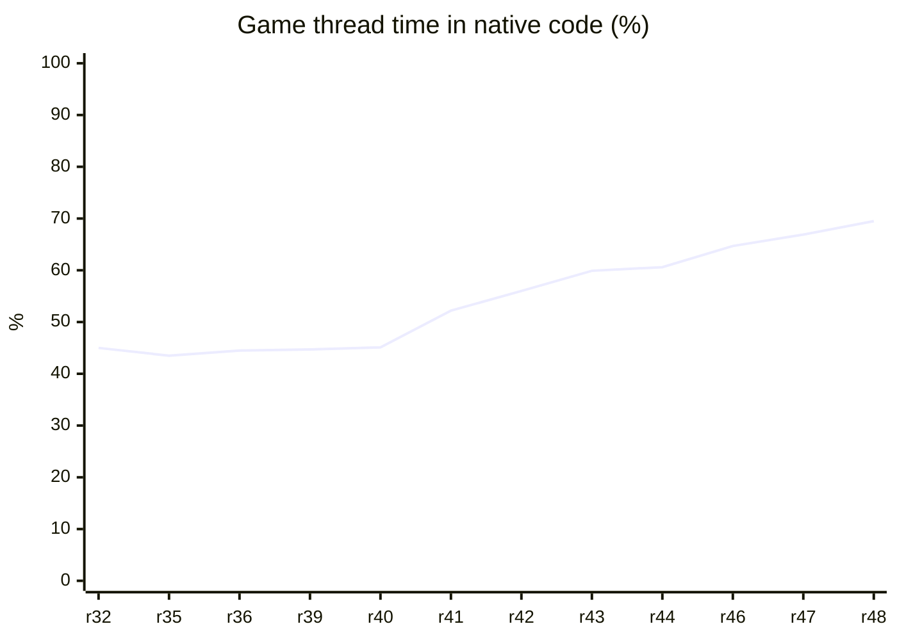

# Celosia

A native port of **Shadow of the Colossus** (PS2, USA, SCUS-97472) to macOS
(Apple Silicon) and the **PS Vita**, built by statically recompiling the
game's MIPS code to C++ with [PS2Recomp](https://github.com/ran-j/PS2Recomp).

No emulator runs the game's CPU code. The EE code from the boot ELF and the
game's three XFF modules is translated into C++ ahead of time and compiled
natively. The game is drawn by a native renderer (Metal on the Mac, OpenGL
ES on the Vita) that reads its model data directly. The rest of the hardware
it talks to (DMA, IOP, SPU2) is reimplemented as host code.

**Progress page: [henrykun55.github.io/celosia](https://henrykun55.github.io/celosia/)** (recompilation, decompilation by area, next targets, rounds). **Where it stands: [docs/STATUS.md](docs/STATUS.md)**.

> **No game data is included.** You need your own copy of the game.

## Status


| Area | State |
| --- | --- |
| Boot, logos, intro cinematic | ✅ |
| Native renderer (models, characters, 2D, fog, bloom, shadows, reflections, water…) | ✅ all 49 tracked features native |
| Audio (SPU2: voices, ADSR, reverb, streaming) | ✅ |
| Title screen, menus | ✅ |
| Memory card (libmc2, PCSX2-compatible `memcards/Mcd001.ps2`) | ✅ |
| New Game, intro, riding Agro, gameplay | ✅ |
| Performance, Mac (M4 Pro) | 60 fps, drawn at 1536×1344 |
| PS Vita | ✅ builds and runs (18–25 fps in Vita3K's intro); fidelity and speed in progress |
| Decompilation | started: software doubles rewritten and proven ([docs/decomp.md](docs/decomp.md)) |

## Requirements

- macOS on Apple Silicon, Xcode Command Line Tools
- `brew install cmake ninja pkg-config ffmpeg python`
- A disc image of **Shadow of the Colossus (USA)** (`SCUS_974.72`), as an
  `.iso` or a `.zip` containing one
- About 10 GB of free disk space and an internet connection for the first build
  (CMake downloads raylib, imgui and sse2neon)

## Quick start

```sh
git clone git@github.com:HenryKun55/celosia.git
cd celosia
./celosia setup --iso "/path/to/Shadow of the Colossus (USA).iso"
./celosia run
```

`setup` takes a while the first time: it compiles the runtime and around 16k
recompiled functions. It briefly opens the game window a few times while it
captures each module (see below).

### Settings

- **F1** (Select twice on the Vita): the player menu. Video, sound,
  language, in Portuguese or English. L1 / R1: tab, up / down: item,
  X or left / right: change, Triangle: help, O or Select: close (the game
  gets no pad input while it is open). Its **Debug** tab (R1 three times)
  changes the developer switches live, without editing `env.txt` or
  rebooting (`env.txt` still sets where they start). Its first rows are
  the **sacrifices** (round 36), each one taking something off the picture
  to save the console's game-thread time, game logic untouched, saved in
  `settings.cfg` (the Vita's default: fewer particles on; the Mac: all off):
  **Fewer particles** ("Partículas reduzidas", `SOTC_SAC_PARTICLES`: every
  emitter makes half as many) and **Coarser model detail** ("Detalhe reduzido",
  `SOTC_SAC_LOD`: detail levels picked as if 1.6x as far; nothing
  disappears; off by default). `SOTC_SACRIFICES=0` turns them all off at
  start. Its **Quality** tab ends with the **performance cuts** (round 65,
  all off by default, saved in `settings.cfg`): **Fewer camera checks**
  ("Menos checagens da câmera", `SOTC_SAC_CAMCOLL`), **Distant characters
  at half rate** ("Personagens distantes a meia taxa", `SOTC_SAC_FARCHARA`),
  **Effects at half rate** ("Efeitos a meia taxa", `SOTC_SAC_FX`), **Shorter
  draw distance** ("Distância de visão menor", `SOTC_SAC_DRAWDIST`) and
  **Max performance** ("Desempenho máximo", `SOTC_SAC_MAX=1`: all four). On the Vita the picture is always capped at 30 fps in frames with
  a scene (round 36; not a menu item there; loading screens, logos and
  black frames are not capped, so the loader is never held back;
  `SOTC_CAP30=0` / `SOTC_CAP30_ALWAYS=1` for testing). **Mark this moment**
  writes `[mark] <n> frame <f>` to the log (`err.txt` on the Vita) to find
  a moment later; **Performance overlay** shows fps, the frame's time split
  (game, hooks, render thread, wait, present), the worst frame of the last
  4 s and a frame-time graph with the menu closed (`SOTC_PERF_OVERLAY=1`);
  the frame and sound logs (`SOTC_FRAME_LOG`, `SOTC_FRAME_LOG_ALL`,
  `SOTC_AUDIO_LOG`), the Vita's glow layer (`SOTC_GLOW_VITA`), the bloom's
  frame (`SOTC_BLOOM_SAMEFRAME`), and the renderer's other switches.
  **Record scene** ("Gravar cena"): X once, close the menu, play; a "REC"
  marker shows while everything the native renderer draws is written to
  `ux0:data/celosia/rec/<date_time>/` (`logs/rec/` on the Mac): each
  frame's draw list, effect settings, timing split, the pad and sampled
  guest pcs, and every 10-60 frames the whole frame (matrices, states,
  vertices, palettes, textures), through cutscenes and area changes. X
  again stops it (or 15 min / 700 MB / a nearly full card).
  `tools/rec.py` lists a recording, prints a frame's draws, exports its
  textures and draws its full captures again with this build's renderer
  to PNG (whole, without the glow composite, layer by layer); see
  [docs/decomp.md](docs/decomp.md), round 25.
- **F10** (Mac): the native renderer's panel. Resolution (× 512×448), bloom
  strength, fog amount and every effect on/off, changed live. "Print to log"
  gives the setting as `SOTC_*` variables that set it at start. The table is
  in [docs/STATUS.md](docs/STATUS.md#settings).
- **F9** (Mac): flips the picture shown between the native renderer's and the
  emulated GS one of the same moment (a "NATIVE" / "GS (emulated)" label shows
  for two seconds). With `SOTC_NATIVE=2` both are drawn every frame, so the
  flip is instant (it starts on the GS picture); with the default
  `SOTC_NATIVE=1` the GS starts drawing again when its picture is asked for
  (a few frames). Round 37: in the host loop, so it works without the
  debugger's build too.
- **F8** (Mac): saves the same moment twice to `shots/` (the folder the game
  runs in): `f8_<n>_emulated.png` (the GS picture, drawn for those few frames
  whatever F9 shows), `f8_<n>_native.png` and `f8_<n>_draws.txt` (the native
  draws of that frame). Works in both `SOTC_NATIVE=1` and `=2`.
- **F12**: the developer debugger (CPU, threads, DMA, memory).

### Controls

A gamepad works out of the box. Keyboard:

| Keys | PS2 |
| --- | --- |
| W A S D | left stick |
| arrows | D-pad |
| H / J | ✕ / ○ |
| Y / U | □ / △ |
| I / O | L1 / L2 |
| K / L | R1 / R2 |
| Z / X | Start / Select |

## How it works

Shadow of the Colossus ships one small boot ELF and loads the rest of its code
at run time: `KERNEL.XFF`, `MANAGER.XFF` and `GAMECORE.XFF`. These are
relocatable modules that the game links in memory with its own dynamic linker.
A static recompiler needs all of that code up front, so `setup` bootstraps it
in stages:

1. **Boot ELF.** Function boundaries are recovered with `tools/funcmap_elf.py`.
   Symbol names come from `KERNEL.XFF`'s imports. The ELF is recompiled with
   `game/scus.toml`.
2. **Module capture.** The game runs until it jumps into code that is not
   recompiled yet, which is the next module's entry point. Guest RAM is saved
   at that moment (`PS2X_DUMP_RAM_ON_MISSING`). The loaded module (sections at
   their final addresses, symbols resolved) is cut out of the dump.
   `tools/modimage.py` locates the module header automatically.
3. **Link.** `tools/build_elf.py` merges the boot ELF and every captured module
   into one `SOTC.elf`, with a function map and the list of instructions the
   guest linker rewrites (`dynamic_imm.txt`). The recompiler decodes those
   instructions from memory at run time. `tools/gen_config.py` writes the
   recompiler config.
4. Steps 2 and 3 repeat for KERNEL → MANAGER → GAMECORE.
5. **VU1.** A scripted run records every VU1 microcode image the game uploads.
   Each image is compiled to C++ (`./celosia vu1`). New images seen while
   playing are saved automatically, and `./celosia vu1` picks them up.

Everything generated (recompiled code, captures, build files) goes to
`build/`. None of it is committed.

## PS Vita

```sh
export VITASDK=~/vitasdk
./celosia vita          # after ./celosia setup: build/vita/ps2xRuntime/ps2EntryRunner.vpk
```

The first run also builds vitaGL at a pinned revision with this port's
patches. Install the `.vpk` (VitaShell, or File › Install in Vita3K). Then
put the extracted disc in `ux0:data/celosia/disc/`. Saves go to
`ux0:data/celosia/memcards/` and logs to `ux0:data/celosia/log.txt` and
`err.txt`. The Vita has no environment: `ux0:data/celosia/env.txt` takes
`NAME=value` lines (for example `PS2X_PROFILE=ux0:data/celosia/prof.txt`).

## Decompilation

The recompiled code works but is not readable. Functions that matter are
being rewritten by hand in C++ and proven equal to the recompiled ones, byte
for byte, on the same machine state (`SOTC_DIFFTEST`). It is a functional
decomp, not a matching one. The workflow (guest profiler, Ghidra scripts,
difftest) is in [docs/decomp.md](docs/decomp.md).

Progress (2026-10-30, round 35; code and call figures from round 28's count):
**5.4%** of the MIPS code (450 of 9,024 functions, the SDK / libc pieces the
runtime implements included; 3.2% of the game's own code), but **48%** of the
guest calls already land in native code (call counts of the attract demo and
the route to frame 4 800): the rewrites go after the hottest functions first.
By time, **43%** of the Vita game thread's instructions run in native code,
**39%** still in recompiled MIPS and 18% in the runtime (DMA walk, memcpy,
scheduler, the glue that calls guest code), from a Vita3K profile of the route
(180-300 s). The recompiled share is spread thin (its biggest function is
1.5%), so it shrinks by rewriting whole subsystems, not single hot spots.
`tools/decomp_tree.py` splits both figures by area of the game
([docs/decomp_tree.json](docs/decomp_tree.json)). Every native function is
listed in [docs/decomp_status.json](docs/decomp_status.json)
(`tools/decomp_status.py` recounts it); the history is in
[docs/decomp_history.json](docs/decomp_history.json) (`tools/decomp_history.py
--add --label rNN [--profile LATE EARLY ELF THREAD]` appends a measurement;
`tools/decomp_tree.py --readme` rewrites the tables below).

<!-- decomp:start (tools/decomp_tree.py --readme writes this block) -->

**Game thread time on the Vita** (r48, Vita3K profile of the route):

| | share | |
|---|---:|---|
| Native code | 69.5% | `██████████████░░░░░░` |
| Recompiled MIPS | 15.9% | `███░░░░░░░░░░░░░░░░░` |
| Runtime (DMA walk, memory, scheduler, glue) | 14.5% | `███░░░░░░░░░░░░░░░░░` |

<details open>
<summary><b>By area of the game</b>: what is native and what still runs as recompiled MIPS</summary>

| Area | Code native | | Functions | Game thread time: native / MIPS |
|---|---:|---|---:|---|
| Display and models | 18.2% | `██░░░░░░░░░░` | 43 / 971 | 23.4% / 2.9% |
| Characters and motion | 14.5% | `██░░░░░░░░░░` | 60 / 1204 | 17.1% / 2.6% |
| Other game code (names not identified yet) | 10.6% | `█░░░░░░░░░░░` | 92 / 2889 | 8.5% / 5.9% |
| Collision and physics | 18.6% | `██░░░░░░░░░░` | 47 / 337 | 13.2% / 0.7% |
| System and memory | 6.6% | `█░░░░░░░░░░░` | 6 / 230 | 3.0% / 0.2% |
| Script and events | 1.6% | `░░░░░░░░░░░░` | 12 / 632 | 2.0% / 0.3% |
| Math | 30.4% | `████░░░░░░░░` | 26 / 131 | 1.8% / 0.4% |
| Boot ELF, SDK and libc | 16.4% | `██░░░░░░░░░░` | 349 / 2128 | 0.0% / 2.1% |
| Particles and effects | 39.3% | `█████░░░░░░░` | 12 / 119 | 0.6% / 0.4% |
| Camera | 0.0% | `░░░░░░░░░░░░` | 0 / 281 | 0.1% / 0.4% |
| Sound | 0.0% | `░░░░░░░░░░░░` | 0 / 102 | 0.0% / 0.1% |
| Runtime (DMA walk, memory, scheduler) | | | | 14.5% (runtime) |

</details>

<details>
<summary><b>History</b></summary>

| Measured | Commit | Code native | Calls native | Game thread time native |
|---|---|---:|---:|---:|
| 2026-10-23 | ed10257 | 4.24% | 34.1% |  |
| 2026-10-23 | fce6b0c | 4.31% | 39.6% |  |
| 2026-10-23 | e51649c | 4.51% | 40.3% |  |
| 2026-10-24 | 33afe16 | 4.65% | 40.6% |  |
| 2026-10-25 | d44f871 | 4.69% | 40.9% |  |
| 2026-10-25 | 23595fb | 4.73% | 41.6% |  |
| 2026-10-26 | a7829ef | 5.25% | 51.4% |  |
| 2026-10-27 | bb0bfd8 | 5.25% | 47.5% |  |
| 2026-10-27 | d2d8bb1 | 5.30% | 47.7% |  |
| 2026-10-27 | 3dfcd50 | 5.40% | 47.8% |  |
| 2026-10-29 | a61cb0d | 5.41% | 47.9% |  |
| 2026-10-29 | r32 | 5.41% | 47.9% | 45.0% |
| 2026-10-30 | r35 | 5.41% | 47.9% | 43.5% |
| 2026-10-30 | r36 | 5.41% | 47.9% | 44.5% |
| 2026-10-30 | r39 | 5.59% | 49.0% | 44.7% |
| 2026-10-30 | r40 | 5.73% | 49.1% | 45.1% |
| 2026-10-30 | r41 | 7.49% | 51.3% | 52.2% |
| 2026-10-31 | r42 | 7.67% | 53.7% | 56.0% |
| 2026-10-31 | r43 | 8.66% | 54.1% | 59.9% |
| 2026-10-31 | r44 | 8.93% | 54.9% | 60.6% |
| 2026-10-31 | r46 | 10.89% | 56.2% | 64.7% |
| 2026-10-31 | r47 | 11.68% | 58.1% | 66.9% |
| 2026-10-31 | r48 | 12.71% | 64.8% | 69.5% |

</details>



<!-- decomp:end -->

## Commands

```
./celosia setup [--iso PATH]   full pipeline (extract → capture → recompile → build)
./celosia run                  play (log: logs/play.log)
./celosia vu1                  compile newly seen VU1 microcode and rebuild
./celosia recompile            relink modules, recompile and rebuild
./celosia build                rebuild after editing PS2Recomp sources
./celosia autotest [s] [int]   scripted run, screenshots every int s in shots/run
./celosia vita                 build the PS Vita VPK
./celosia clean                delete build/
```

| Setting | Default | Meaning |
| --- | --- | --- |
| `CELOSIA_DISC` | `./disc` | extracted disc |
| `CELOSIA_BUILD` | `./build` | build and generated code |
| `CELOSIA_JOBS` | CPU count | parallel compile jobs |
| `CELOSIA_CMAKE_ARGS` | | extra CMake configure arguments |
| `CELOSIA_VITA_CMAKE_ARGS` | | extra CMake configure arguments of `./celosia vita`; e.g. (round 66) `-DPS2X_VITA_FUNCTION_SECTIONS=OFF` for the old code layout (no `-ffunction-sections`, no hot-code order), `-DPS2X_VITA_HOT_ORDER=<file>` for another order file than `game/overrides/vita_hot_order.ld` (written by `tools/vita_hot_order.py` from Vita3K profiles: the sampled functions hottest first at the start of `.text`) |

### Runtime switches (debugging)

| Variable | Effect |
| --- | --- |
| `PS2X_INPUT_SCRIPT="11:DOWN:0.3;12:CROSS:0.3"` | scripted button presses (second:button:duration) |
| `PS2X_SNAPSHOT_DIR` / `PS2X_SNAPSHOT_SECONDS` | periodic screenshots |
| `PS2X_STATS=1` | frame, VU1 and GS statistics |
| `PS2X_GS_BOB=1` | bob deinterlacing instead of weave |
| `PS2X_GS_THREADS=n` | raster threads |
| `SOTC_NATIVE=1` / `2` | native renderer shown (default) / drawn but not shown, for side-by-side checks |
| `SOTC_NATIVE_GL=1` / `check` | the OpenGL renderer on the Mac / compared against Metal |
| `PS2X_GS_GPU=0` | emulated view rasterized on the CPU (exact GS fog: the reference for fidelity checks) |
| `PS2X_MTVU=0` | run VIF1/VU1/GIF on the game thread instead of their own thread |
| `PS2X_GIF_THREAD=0` | process GIF packets on the VU1 thread instead of their own |
| `PS2X_GS_PROFILE=1` | where GS raster time goes, and what flushes the draw queue |
| `PS2X_VU1_NOREC=1` / `PS2X_VU1_REC_VERIFY=1` | interpret VU1 / cross-check the recompiled VU1 against the interpreter |
| `PS2X_WATCH_WRITE=start:end` | log guest stores to an address range |
| `PS2X_DUMP_RAM_AT_SECONDS=n` + `PS2X_DUMP_RAM_PATH` | save guest RAM |
| `SOTC_EE_TRUST=1` (Debug "Plain floats") | Vita: the lean hot code's second copy with plain floats (no PS2 operand clamps or adder alignment; ~3% faster, not exact, off by default); `SOTC_EE_TRUST_AB=n` alternates every n frames |
| `SOTC_SKELETON_FAST=0` / `SOTC_SKELETON_FAST_AB=n` | the skeleton pose's round 25 path instead of the register-local one (exact either way) |
| `PS2X_DMA_WALK2=0` | the VIF1 chain walk's round 30 loop and walker (default: round 31's, main RAM tags without the address translation, the walker's state in locals; exact either way) |
| `PS2X_DMA_CACHE=1` | the VIF1 chain's packet cache: a CALL target's packet walked before whose bytes are unchanged has its effect replayed (exact; off by default: slower than walking it in Vita3K) |
| `SOTC_DMACACHE_CHECK=1` (with `PS2X_DMA_CACHE=1`) | each VIF1 chain walked first without the packet cache on copies, then for real, and the VIF1 registers, GS events, MSKPATH3 calls and the channel's registers compared (`[dmacache]` lines) |
| `SOTC_DMA_ASYNC=0` | (round 60) the display list's VIF1 chain walked on the game thread at the kick, as before; by default the host kick (iosDmaSendSChainPath1) hands it to a worker thread (`DMA`, cores 1-2 on the Vita) and leaves CHCR.STR set, and the walk's effects (VIF1 registers, GS SIGNAL / FINISH / LABEL, MSKPATH3, TADR / ASR / CHCR, the channel's completion and the GS interrupt) are applied on the game thread where the guest could first see them: the next VBlank, the host's polls (iosCheckDrawFinish, iosChkGpDlTransExec, the next kick), any DMA / VIF / GIF / GS register access, GIF work; `[dmaasync]` every 1 800 chains (walk time, time in flight, waits, where applied); `SOTC_AB_FLAG` takes `dmaasync` |
| `SOTC_DMA_ASYNC_CHECK=1` | (round 60, checking) each chain also walked on the game thread at the kick (copies, no packet cache) with every byte it reads to decide what it does kept (tags, VIFcodes, STMASK / STROW / STCOL data, the GIF tags and A+D qwords of its DIRECT data); at the apply the worker's walk is compared with it, those bytes with memory then (`touched in flight`), and the walk made again from the kick's state (`[dmaasync] check:` every 600 chains) |
| `SOTC_DMA_ASYNC_DELAY_US=n` / `SOTC_DMA_ASYNC_LOG=1` | (round 60, checking) the DMA worker waits n us before each walk (the guest gets the time to touch a chain in flight); each kick and apply logged with the guest's return address |
| `SOTC_MDS_LANE=0` | (round 61) modelDispState (the game's modelDisp results: the part tree's camera test at +0x2c, the layers' last surface at *0x118bfc8, setShadowEffect's flag, the VU0 CLIP register) on the game thread at each model hook, as before; by default the hook takes its inputs and hands it to a thread of its own (`lane`, cores 1-2 on the Vita) with the hook's own part decision; the model job on the hook worker waits for it; the CLIP register is pending until a reader needs it (clipByMinMaxCube's corners recorded, every other reader and the layer cache's / the flag's users join the lane first); `[mdslane]` every 600 frames (jobs, joins by site, waits); `SOTC_AB_FLAG` takes `mdslane` |
| `SOTC_MDS_LANE_VERIFY=1` | (round 61, checking) at each model hook the old code runs for the game and the lane's code on the same state, and their memory (part table, layer cache, flag), CLIP register, parts and out-of-view decision are compared; the CLIP records made between two hooks are checked against the register (`[mdslane] verify:` every 600 frames) |
| `SOTC_MDS_LANE_DELAY_US=n` / `SOTC_MDS_TRACE=1` | (round 61, checking) the lane waits n us before each job; the census of modelDispState's readers (`[mdstrace]` every 600 frames: model hooks, the CLIP / layer cache / shadow flag users and how often one comes right after a hook) |
| `SOTC_PTCL62=0` | (round 62) the particle geodisps' clip pass and the functions every particle pass asks back to the recompiled code (GetGeoDispClass, get_top_emitter_list_from_particle_geodisp, is_emitter_need_disp, manager_sub_01140C10, clip_particle_geodisp; decomp_ptcl62.cpp); `SOTC_AB_FLAG` takes `ptcl62` |
| `PS2X_SNAPSHOT_EVERY_10MS=1` | (round 62) the EE kernel snapshot (threads, semaphores, event flags: the debug panel's and the logs') made every 10 ms of EE time on the game thread, as before; by default only when a reader asked since the last one (the reader gets it at its next look); `SOTC_AB_FLAG` takes `lazysnap` |
| `SOTC_COLL63=0` | (round 63) the collision leaf (0x112be58) runs every surface past its boundary cylinder through the id filter and ClipCollisionDB as before; by default, with no surface filter, an id filter that only reads the attribute bits (or none) and the surface's plane cached, the plane test comes first and a surface the segment does not cross skips both (f0 and the id record's frame words left as they would be); `SOTC_AB_FLAG` takes `coll63` |
| `SOTC_COLL63_VERIFY=1` / `SOTC_COLL_CENSUS=1` | (round 63, checking) every skip also made the original way and its outcome compared (`[coll63] ... differ`); the census of the collision queries the guest makes through the function table (per caller: calls and host ms a frame, the functions under each, repeats of the same query in a frame, the natives' call counts; with `SOTC_COLLISION_STATS=1` the path counts too), every 600 frames (`[collcensus]`) |
| `SOTC_TEX64=0` | (round 64) texReset's texture loop (each texture's transfer words cleared and texAnim: scroll offsets, palette animation) on the game thread at graphFrameInit, as before; by default it runs on the offload thread (`offload`, cores 1-2 on the Vita) with a copy of the context and is joined before the first reader (texTransRequest, texResetVRAMRequest, texTransResolve, texInitialize / texDelete, the module loader, the display walk, spriteTexFast, modelDisp, meshDisp, iosDlTrans and every hook worker join); `SOTC_AB_FLAG` takes `tex64` |
| `SOTC_TEX64_VERIFY=1` | (round 64, checking) the loop runs on the game thread as before and the offload thread runs it on a copy of RAM taken at the hand-over; at the join the written bytes are compared, the bytes it reads checked for changes in flight and (Mac) every load of the written bytes before the join counted with its reader (`[tex64] verify:` every 600 frames) |
| `SOTC_WALK67=0` | (round 67) the per-object walks' guest lines asked for (PLD) only as before; by default they are asked for further ahead and level by level, for the console's DRAM latency (Vita3K and the Mac do not show it): the display walk's clip and draw windows of the last frame's calls 3 objects ahead (`SOTC_WALK67_AHEAD=<n>`) moved by DispDispObjGroupModel itself, with the walk's own lines, the group chain 4 entries ahead, the sort lists' nodes / objects / +0x260 words in three stages, the bucket array before its clear, the parts' matrices four ahead in 010F3A08 and the GIF packet's next lines in the gl kick; the model hook's texture scroll chains (5 dependent reads a surface) level by level over 32 surfaces; meshDispHook's cloth grid copied in one block 1 KB ahead; a particle system's draw with a runner 4 particles ahead on the +0xa8 links and its display list slots; the collision leaf's boundary records 4 ids ahead and the collision work's parts two ahead. Only reads and prefetches: the same results either way (difftest); `SOTC_AB_FLAG` takes `walk67` |
| `SOTC_PREF69=0` | (round 69) the display walk's prefetch records (round 67's lines a call reads) deduplicated as before, each line compared with every line kept before it; by default through a 64-slot open hash: the same lines kept in the same order (prefetches only), ~1.7 ms less of the game thread at the shrine's altar in Vita3K 222 MHz; `SOTC_AB_FLAG` takes `pref69` |
| `SOTC_SUBSYS_PROF_ONLY=1` | (round 70, measuring) with `SOTC_SUBSYS_PROF=1`, only the `SOTC_SUBSYS_PROF_EXTRA` list is wrapped (the default set's ~2 000 probe calls a frame left out, ~1.3 us each on Vita3K): a narrow inclusive / self breakdown of one subsystem without the probes' own cost in it |
| `SOTC_LINES67=1`, `SOTC_LINES67_EVERY=<n>`, `SOTC_LINES67_SITES=1`, `SOTC_LINES67_REL=1` | (round 67, the Mac, measuring) the walks' cache-line proxy: the game thread's guest reads and writes in the display walk (its own, the clip, the draw), the model / mesh hooks, the particle draw and the collision natives counted as 64-byte lines, per frame: distinct lines, "exposed" lines (first used without a prefetch in an earlier object call or 16 accesses before), lines asked for; `[lines67]` every n frames (300), with SITES the exposed lines by caller (`[lines67-site]`, raw addresses for atos), with REL by offset from the clipped / drawn object (`[lines67-rel]`); nothing in the Vita build (`build/agent-scratch/r67/lines.py` makes the table) |
| `SOTC_READ_CENSUS=tex` / `SOTC_SUBSYS_PROF_TIMELINE=<frame>[:<n>]` | (round 64, the Mac, checking) the census of a subsystem's readers: every load of the generated code (and of the natives that use the READ macros) from the bytes texReset's loop wrote, until its next run, with the reader and the time after it (`[readcensus]`); with `SOTC_SUBSYS_PROF=1`, every probe's enter / leave in those frames with the time since the frame began (`[timeline]`) |
| `SOTC_CAP30=0` / `1` | (round 36; round 62: a Quality menu item on the Vita again, "30 fps cap" / "Limite 30 fps", on by default until round 64, off by default since (the user's choice), a saved value honoured, this variable over both) the picture shown at most every other refresh in heavy scenes (150 draws or more; off on loading / black frames; `SOTC_CAP30_ALWAYS=1`: always) |
| `PS2X_DMA_STATS=1` | the chain walk's counts every 600 chains (`[dmastats]`: tags, CALLs looked up, replayed, walked) |
| `SOTC_GSREG_ASYNC=0` | the 2D functions' GS writes (fades, cinema bars, menus) wait for the model jobs at every write (default: an untextured batch goes to the worker after them, as glEnd's since round 28; same draws, same order) |
| `SOTC_2D_TEX_ASYNC=0` | a textured 2D batch (glEnd's, the 2D functions') waits for the model jobs (default, round 32: it goes to the worker after them too and looks its texture up there, as the cloth's and particles' jobs do; same draws, same order) |
| `SOTC_ZFOG_JOIN=1` | zFog waits for the model jobs, as before round 32 (default: no wait; its host part is the game thread's alone) |
| `SOTC_HOOK_LEAN=0` | modelDisp's hook as in round 31 (default: the part tree walked once, the palette read straight into the job, matrices and lights as block copies, the next draw's matrix / palette / plan asked for and the prefetch queue pumped during the draw; exact) |
| `SOTC_HOOK_LEAN_CHECK=1` / `SOTC_HOOK_LEAN_STATS=1` | both hook paths each draw and their jobs compared / the hook's work counted (`[hook-lean]` every 600 frames) |
| `SOTC_HOOK_ORDER_CHECK=1` | counts game-thread draws made while model jobs were pending (out of the order the worker keeps) |
| `SOTC_HOOK_WORKER_DELAY_US=n` | testing: each model job held n us (a slow worker, as the console's, for the checks above) |
| `SOTC_REC_SAMPLER_PRIO=n` | Vita: the scene recorder's pc sampler's thread priority (default 96, above the worker / render / build threads; 0: as before round 32, when its samples fell where cores 1-2 went idle) |

| `SOTC_LOG_ASYNC=0` / `=1` | the frame, sound and loader logs written at once (`0`, the Mac's default) or through a 512 KB RAM ring that a writer thread on cores 1-2 empties into `err.txt` every ~50 ms (`1`, the Vita's default, round 33: the console's per-line `err.txt` writes cost the game thread ~5 ms a frame); a line that does not fit is dropped and counted (`[log] n lines dropped`), never waited for; other stderr lines stay synchronous and can come out ahead of buffered ones (round 34 on the Vita: they go through the ring too, `SOTC_LOG_STDERR`) |
| `SOTC_THREADS=0` | Vita: round 32's thread layout (default `1`, round 33: the game thread alone on core 0; the model jobs' worker on cores 1-2 above the render thread's and the builds' priority; the sound callback, main thread and disc readers moved to cores 1-2; render thread core 2, builds and recorder cores 1-2 as before). `[threads]` lines say where each thread runs |
| `SOTC_HOOK_WORKER_PRIO=n` | Vita, `SOTC_THREADS=1`: the model jobs' worker's priority (default 150; 64 is the highest, the threads it shares cores with have the default) |
| `SOTC_THREAD_PRIO=<kind>:<prio>,...` / `SOTC_THREAD_CORES=<kind>:<cores>,...` | (round 70, Vita, console experiments) a thread kind's priority (64 the highest .. 191) and cores (bits: 1 core 0, 2 core 1, 4 core 2) over the layout above; kinds `game`, `worker`, `render`, `build`, `audio`, `main`, `loader`, `recorder`, `log`, `dma`, `lane`, `offload` (e.g. `SOTC_THREAD_PRIO=dma:140,lane:140`); the `[threads]` lines show what was set |
| `SOTC_HOOK_SEMA=0` | Vita: the idle model-job worker sleeps on the condition variable with a 1 ms re-check, as before (default, round 33: a kernel semaphore, one signal a hand-over, no timed re-checks) |
| `SOTC_GL_PRESSURE_POOLS=0` | Vita: under heap pressure (not critical) evict every mesh / texture unused for 8 s, as before (default, round 33: while vitaGL's pools have room only textures that live in the newlib heap go; the others free no heap and were rebuilt and uploaded again, the console's hitches; `kept in pools n` in `[gl:mem]`) |
| `SOTC_KICK_DEFER=0` | the model jobs joined at each display list's kick and its skinned pass made there on the game thread, as before (default, round 34: the bone palettes its hooks saw are copied at the kick and the pass is a worker job behind the frame's model jobs, joined at the next frame's first hook; each model job takes its instance chain, the mip K scale `*0x118c180` and its plan's texture scroll rows at the hook, the things the game changes for the next frame; a frame with a draw without a plan joins at the kick as before; `[skin-kick]` with `SOTC_SKIN_KICK_LOG=1` counts both) |
| `SOTC_KICK_DEFER_CHECK=1` | Mac, checking `SOTC_KICK_DEFER`: the worker is held from each kick to the next join and the held jobs run on a copy of guest memory taken at the kick (protected, so every page they read is marked); each page read is compared with guest memory at the join (`[kick-check]`); a build with `-DSOTC_READ_TRACK` (r34/rt) also marks every guest word the jobs read and names its reader |
| `SOTC_LOG_STDERR=0` | Vita: other stderr lines written at once, as before (default with `SOTC_LOG_ASYNC`, round 34: every stderr write goes into the log ring from the game thread's start on, the writer thread alone writing `err.txt`; the game thread's `[irq] dispatch` lines, seven card writes each, came right before 62 of the 63 in-game frames over 120 ms of round 32's console session) |
| `SOTC_GL_POOL_COMPACT=0` | the renderer's mesh pools (2.3 MB of vitaGL memory each) let go only when empty, as before (default, round 34: every 30 frames the emptiest pool under half full is emptied into the others' free room, 16 K vertices a frame, its run copies dropped, then let go; `mesh pools ... emptied n, MB moved` in `[gl:mem]`) |
| `SOTC_VGL_POOLS=console` | Vita3K testing: vitaGL's pools sized as on a console (CDRAM 96 MB, main RAM 16 MB, phycont 26 MB) instead of from Vita3K's larger free memory; `[vita:mem]` counts what each pool holds and the GPU objects vitaGL put in the newlib heap (`celosia.patch`, round 34) |
| `SOTC_VGL_CIRCULAR_KB=n`, `SOTC_VGL_IMMEDIATE_KB=n` | Vita: vitaGL's circular pool (client-array vertices, the immediate-mode pool; a third a frame in flight) and immediate-mode (glBegin) pool sizes; `32768` / `4096` as before (default, round 35: `3072` / `64`: the port used 4 097 KB a frame at most, 4 096 of it the immediate pool it never draws with; a frame that needs more takes it from the pools, counted in `[vgl:dump]`): 29 MB of vitaGL's main-RAM and phycont pools back |
| `SOTC_GL_SCRATCH_DEPTH=0` | Vita: every render target gets a depth buffer of its own, as before (default, round 35: the targets made without depth, which no draw tests depth or stencil on, share one scratch depth buffer per size, `vglFramebufferScratchDepth`; `[vgl:dump]` counts draws with a depth / stencil test on one, which stays 0): ~1 MB of CDRAM per target at 512 x 448 |
| `SOTC_GL_SHADOWMASK_VITA=1` | Vita: the shadow mask target made and cleared each frame, as before (default, round 35: not made; the Vita's shadow pass returns before drawing it) |
| `SOTC_VGL_MEMDUMP=<s>` | Vita: every s seconds `[vgl:dump]` lines: what vitaGL's pools hold by the code that asked for it (sites resolve against the ELF; "dump base" is `vglCeloMemDump`'s address), the circular / immediate pools' peaks, render targets and their driver memory, scratch depths, and each framebuffer's depth (own / scratch / shared); `[native:gl] targets:` names the renderer's framebuffers |
| `SOTC_PLAN_STATS=1` | also counts the jobs' plan walk (`[plan] ... jobs' walk`: packets looked at, left out by the part / surface test, part runs) |
| `SOTC_SACRIFICES=0` | round 36: every sacrifice off at start (each one's own variable below still wins; saved `sac_*` values in `settings.cfg` are ignored while it is set) |
| `SOTC_SAC_PARTICLES=0/1` | Debug "Fewer particles" ("Partículas reduzidas"): each particle emitter's rate halved (the carried fraction keeps the average; an emitter's first frame still makes one) and at most half its live particles (rounded up); the Vita's default 1 |
| `SOTC_SAC_LOD=0/1` | Debug "Coarser model detail" ("Detalhe reduzido"): modelClipSolid picks the level as if the model were 1.6x as far, only for LOD records that keep their last level past their range (+0x28 clear: nothing vanishes sooner, terrain included); off by default (no game-thread saving measured on the route) |
| `SOTC_SAC_CAMCOLL=0/1` | (round 65) Quality "Fewer camera checks" ("Menos checagens da câmera"): the camera's look / visibility segment tests (camera_collision_check_direct from the subjective and objective target visibility and the target offset's two sites, and the "leave" attribute's ClipCollisionDirectCallBack) run in even game frames only; in odd frames each site's n-th call gets the answer of its n-th call the frame before (v0 and the 0x50-byte result). The test that places the camera (CAM_act_ray_check_for_camera) and every other caller run every frame; off by default; `SOTC_AB_FLAG` takes `saccam` |
| `SOTC_SAC_FARCHARA=0/1`, `SOTC_SAC_FARCHARA_DIST=<d>` | (round 65) Quality "Distant characters at half rate" ("Personagens distantes a meia taxa"): a character farther from the camera than d (default 40) plus twice its collision sphere's radius (+0xe00's w: a colossus whose body reaches the camera is never far) has GetMotionMatrix (its pose) made every other frame (by its address's parity), the frame between keeping the pose of the frame before (only when made then into the same buffers, and never for a character with sub geometries); root dynamics, IK, bone products, cloth and callbacks run every frame; off by default; `SOTC_AB_FLAG` takes `sacchara`; `SOTC_SAC_STATS=1`: `[sac-farchara]` lines (poses a frame, far, left out, distances) |
| `SOTC_SAC_FX=0/1` | (round 65) Quality "Effects at half rate" ("Efeitos a meia taxa"): doit_particle_manager steps the particle geodisps (doit_particle_geodisp) in every other call only, the clocks left as they are in the call between and its times (f12, f13, the fixed 1/30) added to the next call's, so speeds, spawn counts and ages keep; the view, the auto-end checks and the layer pass run every call; off by default; `SOTC_AB_FLAG` takes `sacfx` |
| `SOTC_SAC_DRAWDIST=0/1` | (round 65) Quality "Shorter draw distance" ("Distância de visão menor"): modelClipSolid picks the level as if 1.5x as far for the LOD records that drop the model past their range (+0x28 set; terrain's keep their last level), so those models go at 2/3 of their range and take their coarser levels sooner; off by default; `SOTC_AB_FLAG` takes `sacdraw` |
| `SOTC_SAC_MAX=1` | (round 65) the four cuts above on at start (each one's own variable wins); the Quality menu's "Max performance" ("Desempenho máximo") row turns all four on, or off when all four are on. `SOTC_SACRIFICES=0` turns them off too. `SOTC_AB_FLAG` takes `sacall`: all four off together in its windows |
| `SOTC_SAC_AB=<mask>` | measuring: the sacrifices in the mask (1 particles, 4 detail) on for two 60-frame frame-log windows, off for the next two, and so on, with a `[sac-ab] on/off` line after each window's (`build/agent-scratch/r36/abwin.py` pairs them): one run, the same places |
| `SOTC_CAP30=0`, `SOTC_CAP30_ALWAYS=1` | the Vita: the 30 fps cap off / on in every frame (round 36: always on there; round 62: a menu item again; round 64: off by default; it applies while the native renderer's last frame had 150 draws or more and stops under 40: loading screens, logos and black frames run uncapped, `[cap30] on/off` lines say when it switches) |
| `SOTC_GL_PRESSURE_POOLFREE=1` | Vita: round 33's rule for the heap-pressure eviction (spare what lives in vitaGL's pools only while 8 MB of CDRAM and 2 MB of its main-RAM pool are free). Default (round 36): spared whatever the pools' room: the console's RAM pool sits at 8.2 of ~10 MB, so round 33's spare never applied there and every mesh unused for 8 s went every 16 frames, which gave the heap nothing back and brought the walls of a canyon back as holes |
| `SOTC_ASYNC_BUDGET=n` | builds queued on the worker a frame at most (round 36: 500 by default on the Vita, 0 = no limit elsewhere); past it a draw is left out as one still on the worker and queued later |
| `SOTC_TAKEUP_MS=x` | the finished builds taken up at a frame's start for at most x ms, the rest at the next frames in order (round 36: 8 on the Vita, 0 = all at once elsewhere) |
| `SOTC_GL_RUN_EVICT_OLD=1` | the merged-run copies' room made as before round 36 (a scan and sort of every copy for each copy past the budget, again every frame for a run that found none); default: one scan a frame at most, freeing down to 7/8 of the budget |
| `SOTC_CPU_LOG=1` | Mac: `[cpu]` lines every 60 frames with the game thread's CPU time (clock_gettime(CLOCK_THREAD_CPUTIME_ID)) |
| `SOTC_BODY_SHADOWS=0/1` | Renderer "Body shadows" ("Sombras dos corpos", round 37): Wander's, Agro's and the colossi's own shadows on the ground (the skinned shadow volumes; off: only the sword's, as before). On by default on the Mac and, since round 38, on the Vita too (a settings file older than `settings_version=38` has its `body_shadows` ignored once). Round 38: the volumes' shared inner sides are dropped (Wander 6 888 -> ~3 200 vertices, the shrine figures 24 432 -> ~9 850; `SOTC_SHADOW_ALLSIDES=1`: every side, as before), and the Vita's picture framebuffer now has a stencil buffer (without it the console drew no shadow at all; `SOTC_GL_NO_STENCIL=1`: as before). The console log has a `[shadow]` line every 300 frames (volumes and darkening passes a second) |
| `SOTC_ALPHA_TEST=0/1` | Renderer "GS alpha test" ("Teste de alfa do GS", round 38, on by default): the models' GS TEST (GEQUAL 0x40, AFAIL FB_ONLY) per draw: pixels under half alpha (hair and mane cards' edges, a model fading in) draw their colour without writing depth, so they never hide what is drawn after them (a second pass of the draw with the depth read only, only when the texture's and mesh's least alpha say a pixel can be under) |
| `SOTC_BG_DEPTH=0/1` | (round 38, on) layer 1 (the sky and the far landscape) drawn with the depth test into the background image, as the GS draws it into the frame before `bgEnd`'s copy: without it the far trees and the cliffs' far faces were drawn over the near cliffs in draw order (grey blocks and pale angular shapes instead of the mountains on the horizon) |
| `SOTC_FOG_AMOUNT=x` | the vertex fog's share; 1 (the game's own) by default since round 37 (it was 0.55, set by eye against an emulated picture that had no GS fog). A `settings.cfg` / `celosia_settings.cfg` from before round 37 (`settings_version` < 37) has its `fog_amount` ignored once |
| `SOTC_AB_FLAG=<names>`, `SOTC_AB_PERIOD=n` | fidelity A/B (round 37): the named renderer switches (`bloom vfog zfog glow dof shadows sblur feedback ptcl reflect refract subtract additive overlays sky`, round 38: `alphatest bgdepth bodyshadows allsides lighting`, and `L<n>` for display list layer n hidden) off in every other window of n frames (30 by default), so the pairs of one `SOTC_NATIVE=2` run compare the native picture with and without them against the same GS pictures (`build/agent-scratch/r37/ab.py`); `,` or `:` between names |
| `SOTC_SHADOW_LOG=1` | every 60 frames, each shadow volume drawn (`[shadow]`: chain, model, skinned; `[shadowvol]`: extrusion and vertex count) |
| `PS2X_PMODE_LOG=1` | the emulated display's PMODE / DISPFB / DISPLAY registers now and then (`[pmode]`; SotC: 0x8023, both read circuits on the same frame one line apart, blended 50/50) |
| `PS2X_TEST_LOG=1` | (round 38) the emulated GS's primitives counted by context state (TEST, ALPHA, TEX0 PSM / TCC, FBA), printed every 2^20 primitives (`[test]`; `build/agent-scratch/r38/testlog.py` decodes the last dump) |
| `SOTC_LOG_HEADER=<hex>` | (round 38) every 30 frames, each surface of that model as drawn (`[header]`: texture mode, posed, lit, blend, layer, ALPHA_2) |
| `SOTC_CAMCOLL=0` | (round 39) the camera's collision path and the collision filters made native this round back to the recompiled code: `camera_collision_check_direct` / `camera_invisible_collision_check_direct_by_exception_obj`, `GetArbitraryDirectionInverseMatrix` with `iosGetArbitraryUpVectorElement`, `GetQuaternionByAxisDirZYExact` and `iosAbsVector`, the object filters (`CollisionObjectJudgeCallbackExcept(Descend)PluralObj`, `gamecore_sub_0140FAB8` / `01434FC0` / `013D54F0`), the id filters (`CollisionPlaneJudgeCallbackCameraMove`, `playerPlaneJudgeFuncCameraFilter`, `gamecore_sub_01395830` / `013958B8` / `01444800`, `manager_sub_0110C790`), `EntryModifiedManager` and the uncached case of the vertex fetcher `0x1114c70`; each one's table entry alone with `SOTC_DECOMP_SKIP=<name>` (the names in `game/overrides/decomp_collision.cpp` / `decomp_quat.cpp`; the native collision code's own calls of the filters, the vertex fetcher and EntryModifiedManager follow `SOTC_CAMCOLL` only) |
| `SOTC_COLLPROBE=0` | (round 40) the collision natives of round 40 back to the recompiled code: the scripts' collision callback `SCRGetCollisionCallBack`, the id filters `moveCtrlWallJudgeFunc` (the plane's slope in degrees), `gamecore_sub_013CB8E8` and `AI_JudgeColAttrFunc`, `GetCollisionDBPlane` and the water probes `manager_sub_01117EA0` / `manager_sub_01117340`; each one's table entry alone with `SOTC_DECOMP_SKIP=<name>` (the native collision code's own calls of the filters follow `SOTC_COLLPROBE` only) |
| `SOTC_MOTION=0` | (round 41) the character / motion natives of round 41 back to the recompiled code: the motion accessors (`getBlendLastMotion`, `GetMotionVersion`, `GetMotionNbOptionNodes`, `GetMotionOptionNodePhysicalId`, `GetOptionNodePhysicalNodeId`, `GetMotionNodeBasePos` / `GetMotionNodeBaseQuaternion`, `GetMotionFloatFrameNoCaribration`, `GetMotionIntFrame`), the pose's root `GetMotionMatrix`, `ExecCharaGeometry` and its chain (`CalcNodeInterp`, `CalcNodeQuaternionWithIK`, the option nodes `manager_sub_010BC4F0` with `AddCharacterClassOptionNodeSubGeometries`, the gaze `manager_sub_010C6238`, `UpdateLayoutClassSimpleGeometry`), the control definition walker `manager_sub_010CA230`, `manager_sub_010C71D8`, `manager_sub_010CF210`, `getAmbientColorC`, `AI_GetSmallAnimalAIParam`, `FlushPadHistory`, `texTransResolve`, `clothmath_doubleTensionMove`, `gamecore_sub_013B8DC8`; each one's table entry alone with `SOTC_DECOMP_SKIP=<name>` (the natives' direct calls of each other follow `SOTC_MOTION` only) |
| `SOTC_LEAVES=0` | (round 42) round 42's natives back to the recompiled code: the display list's layer stack `iosDlPushLayer` / `iosDlPopLayer` and the camera context `iosgluGetCameraContext` / `get_cur_camera_context` (the first three behind sotc_native's hooks, which now call the natives), `iosDlGetLayer`, `transMicroCode`, the 2D sprite `spriteNoTexFast`, `floorf`, `strcmp`, `iosFTOI4Vector`, `iosGetScaleMatrixV`, `CopyMultiMatrix`, `UpdateLayoutClassPastSimpleGeometry`, `FlushCollisionWork` / `FlushCollisionWorkByWorkStruct`, the IK feet's id filter `character_ikcolattrfilter`, `GetLayoutClass`'s script / camera / light cases, the motion frame wrappers `GetMotionFloatFrame` / `getMotionFloatFrame` / `getMotionFloatFrameWithLimitCaribration`, the camera parameter copy `gamecore_sub_014274A8`; each one's table entry alone with `SOTC_DECOMP_SKIP=<name>` (also for the three behind the hooks) |
| `SOTC_HOTLIST=0` | (round 43) round 43's natives back to the recompiled code (the list in docs/decomp.md, "Round 43"); each one's table entry alone with `SOTC_DECOMP_SKIP=<name>` |
| `SOTC_SEMA_FAST=0` | (round 43) `SignalSema` through the runtime's syscall stub every time (default: the uncontended case, no waiter and room in the count, done in the table entry without the syscall's set-up; also off with `SOTC_DECOMP=0` or `SOTC_DECOMP_SKIP=SignalSema`) |
| `SOTC_HOTLIST44=0` | (round 44) round 44's natives back to the recompiled code: `gsReg` (behind sotc_native's 2D hook), `GetQuaternionByEulerYXZ`, `execCondition`, `manager_sub_01129988`, `manager_sub_01118B88`, clipCollisionKeep's full test (0x111c078), `gamecore_sub_013E30D0` / `013448C0` / `0141F310`, `_setNodeHPB` / `_setNodeHPBIllegal`, `manager_sub_010AC4A0`, `manager_sub_01102638`, texTransResolve's whole walk; each one's table entry alone with `SOTC_DECOMP_SKIP=<name>` |
| `SOTC_HOTLIST46=0` | (round 46) round 46's natives back to the recompiled code: the foot IK step `gamecore_sub_01372068`, Agro's body step `gamecore_sub_01391E30`, `manager_sub_010C4220` (root / pose blend), `manager_sub_010CABA0` (a character's control step), `CheckControlDef`, `gamecore_sub_01397110` (a cloth strip's pass), `updatePowerWork`, `gamecore_sub_0135AE50` (the stage area grid), `DispWithSwordBlur`, `manager_sub_010E1068` (aim IK), `nico_IK_legCalcAndSetUpper`, texTransResolve's type-1 and texture-only work records, the cloth strings' objects (clothVelocity's type-1 path), and the fight's `ClipCollisionDirectCallBackObjAry`, `ClipCollisionFinderWithKeep4DSlopeLimitCB`, `manager_sub_010AE128` / `010ADE08` / `010AEAF8` / `010AF070` (option-node / object-animation keys), `ExecObjectAnimation`, `updateObjectGeo`, `GetObjectAnimationFloatFrame`, `GetMotionDirectResourceNodeQuaternionPosFloatFrame`, `manager_sub_0113DBF8` / `0113E6C8` / `0113DEA0` (particle draws), `manager_sub_01108960` (the geometry pointer kick); each one's table entry alone with `SOTC_DECOMP_SKIP=<name>`; `SOTC_AB_FLAG` takes `hotlist46` |
| `SOTC_HOTLIST47=0` | (round 47) round 47's natives back to the recompiled code: `manager_sub_010BC718` / `010BC2F8` (the option nodes' positions / root poses), `manager_sub_010BC900` (a character's geometry step), `gamecore_sub_013F8B58` (the player's life bar layout), `charrootdyn_slideExceptionJudgeCB`, `GetCharaRootDynamics`, `GetCharaRootDynamicsAfter`, `doit_particle_manager`, `get_particle_parameter_blend_doit`, `doit_expression`, `gamecore_sub_013BA790` (a string point's length keep), `manager_sub_010AB6D0` / `010AB848` / `010AB9A0` (the VRAM block allocator), `manager_sub_010CF210`'s matches (its no-match searches stay round 41's), `GetCharacterClassOptionNodeGeo`, `StageManagerCheckAreaExist`, `manager_sub_01118340`, `getClothDynamics`, `GetCollisionDBCallBack`, `GAMEUTIL_doit_interp_value_cntrl`, `GetSkeletonFocusNode`, and texTransResolve's CLUT work records; each one's table entry alone with `SOTC_DECOMP_SKIP=<name>`; `SOTC_AB_FLAG` takes `hotlist47` |
| `SOTC_SCRIPTVM=0` | (round 48) the script system's natives back to the recompiled code: the sub-threads' frame end `gamecore_sub_013CF258` (a coroutine native entered at its resume labels after each sleep), `scrRun`, `scrRunM`, the SCR data interpreter `execSCRBaseFunc` and its opcodes (`SCRFuncSubFunc`, `SCRFuncConditionExecFunc`, the hot `SCRCondition*` / `SCRFunc*`), the frame end's per-type helpers (`013CFCA0`, `013CFE40`, `013CFBE0`, `013CFD80`, `013CF4E0`), the script class accessors, `ExecScriptLayoutObj`, `CheckLetter`, the script control status, `isysGetThisSubThread`, and the small animal's script body `gamecore_sub_013E3840`; a sub-thread asleep inside a native frame resumes in the recompiled code (the frames are the original's); `SOTC_AB_FLAG` takes `scriptvm` |
| `SOTC_ISYS=0` | (round 48) the isys object lifetime's natives back to the recompiled code: `isysDeleteGroupAllObj`, `isysDeleteObjManager`, `isysRequestDeleteObj`, `isysGroupForFirstForce`, `isysObjDeleteUnLock`, `isysObjWaitSema` / `isysObjSignalSema` (nested only), `kernel_sub_001BF590` (the display list reset), `isysGetGroupSrhNext`, the letters (`isysLetterObjDiscardLetterAll`, `open_letter_post`, `discard_all_letter_in_post`, `close_letter_post`) and `texTransRequest` (behind sotc_native's hook); `SOTC_AB_FLAG` takes `isys` |
| `SOTC_HOTLIST48=0` | (round 48) round 48's other natives back to the recompiled code: `manager_sub_0109E2A0` (the bloom chain), `graphFrameInit`, `gsRegEnd`, `gamecore_sub_013D8B38`, `SpriteMenuSetSpriteObjectParam`, `bossDeathEffectEnd` (its idle path), `GetCollisionDBEdgeInfoNext3`, `AI_GetRotVelocity`, `GAMEUTIL_get_spring_interpolate_value3D_extend`, `manager_sub_01115D00`, `AddCharacterClassSubGeometries`, `CopyMultiQuaternion`, `GetWindVector`; each table entry alone with `SOTC_DECOMP_SKIP=<name>`; `SOTC_AB_FLAG` takes `hotlist48` |
| `SOTC_FASTNATIVE=0` | (round 49) the hottest natives' round 49 fast paths off, round 48's code back: host pointers instead of guest address translation, values in locals and plain NEON where the PS2 clamps provably change nothing (the A32 clamp-free paths run only on the Vita) in modelDispState, texAnim / texReset / texReset's frame start, charaLinks, clothStep, the garbage tick's time check, evalKey, the light pass, the control conditions, the point sort, modelClip, UpdateLayoutClassGeometry, the collision leaf / ClipCollisionDB / finder / keep test, GetMotionMatrix's pose and regularizeMatAry; bit-exact either way; read at first use, each native checks it at its entry; `SOTC_AB_FLAG` takes `fastnative` |
| `SOTC_FASTNATIVE2=0` | (round 53) the next natives' fast paths off (round 49's rules: bit-exact, host pointers, values in locals): kbGetStatus / usbdevFrameInit's keyboard state (256 keys a frame, the buffer selector read once, each caller's word written once, when the caller's words lie outside the key state); round 54: the wind zones' walk (manager_sub_01145F78) skips the empty slots in a loop of its own; `SOTC_AB_FLAG` takes `fastnative2` |
| `SOTC_FASTNATIVE3=0` | (round 58) round 58's fast paths off (the same rules: same results, checked): the garbage pass's time check (iosMallocGarbageTickProc) kept from the block before when no guest code ran between them and the EE clock has not moved (the same answer and registers; ~400 checks a frame skipped), the collision finder's duplicate search (CheckCollisionFinderExistData / the finder leaf) over host memory without the per-word range test, and the model hook's texture scroll rows' addresses (hookScrolls) kept a frame per model plan and header (the words still read at each draw); `SOTC_FASTNATIVE_CHECK=1` compares the first two with the exact code, `SOTC_SCROLL_CHECK=1` the third; `SOTC_AB_FLAG` takes `fastnative3` |
| `SOTC_FASTNATIVE_CHECK=1` | (round 49, checking, Vita) each Vita-only fast path's result compared with the exact code's (the exact one is used): `[fastcheck] <name> <checks> <mismatches>` lines every 16 384 checks and at each of the first 8 mismatches (`MISMATCH`); slower, for correctness only |
| `SOTC_FASTNATIVE_STATS=1` | (round 49) `[fncount] frame F <native> <calls>` every 600 game frames for the counted natives (a profile's instructions a frame divide into instructions a call); round 50: also `[exidx]` lookups / cache hits of the unwinder every 2^18 lookups (Vita) |
| `SOTC_EXIDX_CHECK=1` | (round 50, checking, Vita) every answer of the unwinder's cached table lookup (`__gnu_Unwind_Find_exidx`, the EE scheduler's thread-switch exceptions) compared with libgcc's search of the whole table (`[exidx] check:` lines) |
| `SOTC_SBLUR_IDENTITY=1` | (round 51, debugging) the camera blur's identity calls (cameraBlur -> screenBlur with scale 1 +- 1e-5, an angle under 0.0157, no shift: the copies land on the picture itself) drawn anyway; by default they are left out (the Vita made them nearly every moving frame, and drawing them smeared its picture) |
| `SOTC_SBLUR_JOIN=0` | (round 59, testing; A/B name `sblurlazy`, which uses the lazy join outside its own windows) the camera blur's hook waits for the hook worker's model jobs only when it records a blur, not at every call (the identity calls, nearly all of them, record nothing; their wait held the game thread ~4 ms on ~10% of the Vita3K frames). Default: the wait at every call, as before: the lazy join removed the waits but measured no frame-time gain at 222 / 300 MHz |
| `PS2X_XFER_RETURN=0` | (round 52) the EE scheduler's thread switches (a WaitSema / SleepThread / WaitEventFlag that blocks, a SignalSema / WakeupThread / StartThread that readies a higher-priority thread) throw `EeDispatcherTransfer` to the dispatcher again, as before round 52; by default they return: generated code returns at once on `unwinding`, and natives / hooks that would go on after their guest call rethrow there (`PS2Runtime::checkTransfer`) or return (`transferPending`); a raw `syscall` in generated code and the dispatcher's completions still throw; `SOTC_AB_FLAG` takes `xferreturn` |
| `PS2X_XFER_STATS=1` | (round 52) `[xfer] thread switches/s: R returned (N of them rethrown), T thrown` every 5 s |
| `PS2X_XFER_AUDIT=1` | (round 52, checking, Mac) a guest checkpoint reached after a returned thread switch, before the dispatcher (a host frame that went on after its guest call instead of returning or rethrowing): its backtrace, then abort |
| `SOTC_GL_KEEP_TARGETS=0/1` | (round 55, Vita, default 1) render-target memory is not handed back where Vita3K would alias it: the native renderer's two start-up targets (the emulator probe's 16 x 16, the shader warm-up's 1 x 1) are kept, and in Vita3K a GS target that grows keeps its old texture. Vita3K looks every texture up in its cache of colour surfaces first, by address and row stride, and keeps a surface after the guest frees its memory: a texture vitaGL later put there was drawn as the old surface's picture. 0: deleted, as before |
| `SOTC_GS_MEASURE_ROWS=1` | (round 55, Vita) the GS backend's start-up probe of vitaGL's row order run in Vita3K too. By default it is not run in an emulator (it reads nothing back there): its 64 x 64 red-banded targets were the attract demo's red mist in Vita3K (its texture rewrite moves the texture's storage, the freed 16 KB stays a red colour surface in Vita3K's cache, and the next 64 x 64 texture put there, often the canyon mist's puff, was sampled as it) |
| `SOTC_GL_OWN_MIPS=0/1` | (round 55, Vita, default 1) a texture's mip levels uploaded as the PS2 has them (our vitaGL's `vglCeloOwnMips`: `glTexImage2D` levels >= 1 of RGBA8 textures written where vitaGL lays its chain out). vitaGL ignored the texels of those levels and downscaled level 0 with `sceGxmTransferDownscale`, an asynchronous GPU transfer that Vita3K can run after it has already uploaded the chain (it hashes only the first level). 0: vitaGL's downscale, as before |
| `SOTC_SBLUR_PINGPONG=0/1` | (round 55, OpenGL; Vita default 1, Mac 0; A/B name `sblurapart`) a frame's one screen blur (the camera blur's real shifts / zooms, the cutscenes' blurs) drawn on a second picture: the picture so far copied into it with its alpha, the blur's copies read from the first picture and laid over that, the rest of the frame drawn there on the first one's depth (`vglFramebufferShareDepth`); the heat haze's copy at the same layer is made from the same picture first. Before (0): Vita3K drew the scene below the blur's layer a second time into a target of its own (the mid-frame redraw, which smeared there while the camera moved), the console copied the picture mid-frame and took it up again. Metal keeps its own path |
| `SOTC_GL_LEAN_DRAW=0/1` | (round 56, Vita, default 1; A/B name `leandraw`) vitaGL's per-draw work made lighter (our vitaGL's `vglCeloLeanDraw`): a packed draw from one vertex buffer (every attribute active, one stride) patched with all its attributes on vertex stream 0, so one `sceGxmSetVertexStream` a draw instead of one per attribute (4, 6 skinned), the same vertices read; a draw's default uniform buffers (up to ~3 KB with the skin palette) copied with the library's `memcpy` instead of the `sceClibMemcpy` import; the vertex layout cache holds 16 entries instead of 4; round 57: a `glUniform*`'s values copied into the program's uniform buffer (`vglSetUniformData`, the skinned palettes up to 3 KB a call) with the library's `memcpy` too. 0: as before |
| `SOTC_GL_ARENA_CLIB=1` | (round 65b, Vita, debugging) the frame's shared vertex / index buffers and the meshes' own buffers filled by `glBufferData` (vitaGL copies with `sceClibMemcpy`), as before; by default they are made empty and written with the CPU's own `memcpy`. Vita3K runs `sceClibMemcpy` on the host past its buffer write traps, so a draw reading more than 12 KB of a buffer at an address an older frame's data had used got that older data: the thin white spikes out of Wander's and Agro's legs and body (the CPU-posed skinned parts and shadow volumes are drawn indexed from the frame buffer's start), and every frame junk with `SOTC_GPU_SKIN=0` |
| `SOTC_BLOOM_GS_VITA=0` | (round 65b, Vita) the bloom's narrow glow as before (the mask reduced 4 x 4 at the picture's size, a few texels of blur, 0.46 of the strength); by default the GS chain the Mac has drawn since round 20 (256 x 256 mask from the picture's alpha, 128 / 64 reductions, the 64 x 64 history step, the 12-tap blurs onto 64 and 128, stretched over the picture at full strength): the bright sky outside the shrine glows over the pillars and the horizon as on the GS |
| `SOTC_VGL_UNIFORM_KB=n` | (round 65c, Vita, default 2048 as vitaGL) vitaGL's uniform circular pool, from which every draw takes its vertex and fragment uniforms (our vitaGL's `vglCeloSetUniformPoolSize`). It wraps without waiting for the GPU; the console log's `[gl:unif]` line (with `[gl:mem]`) gives the KB of uniforms a frame and the wraps (455-705 KB a frame in the 3D). Suspected of Agro's facets in Vita3K and ruled out (8192: the same picture) |
| `SOTC_GL_SKIN_PRECISE=1`, `SOTC_SHADER_FAST=0` | (round 65c, Vita, testing) the skinning vertex program, or every shader (a shader cache of its own, the VPK's seed left out), compiled by libshacccg without fast math / precision / int (default: fast, as before); neither changed Agro's facets |
| `SOTC_SHADOW_SOFT_VITA=0` | (round 65c, Vita) the shadow volumes' darkening hard-edged, as before; by default soft as on the GS and the Mac: the counted pixels written into the picture's alpha (free until bloomMask), reduced 4 x 4 and blurred (`SOTC_SHADOW_BLUR` rounds, 1), then darkened by it. On the console the mask is made from the picture itself; in Vita3K (the picture is lost when taken up again) from the picture below the volumes drawn again apart (the mid-frame redraw, `SOTC_GL_REDRAW`). The hard edges showed the volumes' own triangles on the bodies casting them: Agro's rump and legs in flat light and dark facets, light seams along the legs, Wander's cloak speckled |
| `SOTC_BLOOM_TAPS=0` | (round 65e; Mac Metal / OpenGL and Vita) the GS bloom chain's 12 blur taps at their full alpha 64 / 32 / 16 as before; by default as the GS draws them: the tap sprites modulate by the texture's alpha (TCC 1), which the temporal step left at its own alpha (0x118c12c), so each tap is (64 / 32 / 16 x that) >> 7 (0x76: 59 / 29 / 14). Full taps lost less to truncation each frame, and through the 92-98% history the glow stood 8-20% above the GS's |
| `SOTC_BLOOM_VITA=1` | (round 65e, Mac OpenGL, testing) the Vita's bloom on the Mac: the mask written into the picture's alpha by a quad at the threshold's depth and the GS chain read from there (the CG modes 8, 11, 15-18 ported to GLSL as 19-24), to measure the Vita's code against the GS on the same frames; with `SOTC_GL_REDRAW=1` Vita3K's order (the glow a frame late) |
| `SOTC_BLOOM_LOG=a-b[,c-d]` | (round 65e, debugging) for those game frames, the bloom's inputs and stages: `[bloom:game]` what the game set (threshold, mask colour, tap alphas, temporal, add colour and alpha), `[bloom:gs]` the GS chain's sprites with their ALPHA / TEST / TEX0 registers and, on the CPU GS (`PS2X_GS_GPU=0`), its buffers' means (mask cover, 488 before and after the temporal step, 510, 480, 448, the picture before and after the add), `[bloom:gl]` what the OpenGL renderer applied (mask depth, tap alphas, every target's mean, the picture before and after its add; read back as 0 in Vita3K). Its read-backs split the picture's scenes: in Vita3K the picture then comes out white; log there only with the read-backs' cost in mind |
| `SOTC_BLOOM_DUMP=1` | (round 65e, debugging, Mac) at each snapshot also `vram_N.bin` (the GS memory: the chain's buffers 336 / 448 / 480 / 488 / 510) and the OpenGL renderer's chain targets of the frame `native_N` shows (`bloom_N_<stage>.ppm`, alpha `_a.pgm`) |
| `SOTC_BLOOM_SHOW=1/2/3/5/6/7/8` | (round 65e, debugging, OpenGL / Vita) the picture replaced by the mask the chain read (1, reduced 4 x 4), the glow it made (2), picture / mask / glow in turn every 90 game frames (3), the 64 x 64 reduction (5), the 64 x 64 history (6), the background image (7), or reduction / temporal step / history in turn (8): what the Vita's bloom works on, in Vita3K's window (its targets cannot be read back) |
| `SOTC_BG_NEAR=<w>` | (round 65e; Metal, OpenGL, Vita) layer 1 (the sky and the far scenery) cut nearer than view depth w; by default the game's own layer-1 near plane (0x1098e20's third camera packet: max(getZFogNear - *0x118c478, 10), 170 in the shrine), which the world microcode clips at; 0: off, as before. The GS draws nothing of the model around the camera inside the shrine (header 0x3a8c60, layer 1); drawn natively, its walls filled the background image the shrine's openings show, a bright stone wall the bloom blew to white |
| `SOTC_BG_FGE=0` | (round 65e; Metal, OpenGL, Vita) no vertex fog on layer 1, as before; by default a layer-1 draw takes it when its surface's GIF tag (+0xd0) has FGE: the far scenery, not the sky (`SOTC_NATIVE_BGFOG=1` still fogs every layer-1 draw) |
| `SOTC_BG_CLEAR_FOG=0` | (round 65e; Metal, OpenGL, Vita) the background image cleared to black as before; by default to the fog colour, as the GS's frame starts from a sprite in FOGCOL under the sky |
| `SOTC_GL_DRAW_SKIP=n` | (round 65e, debugging, OpenGL / Vita) the picture without one kind of mesh draw: 1 the second-texture passes (overlay), 2 GPU-skinned meshes, 3 additive draws, 4 GPU-skinned meshes untextured (vertex colour x light only), 5 GPU-skinned meshes that blend, 6 those that do not, 7 the per-frame meshes (the frame's arena: parts posed on the CPU, particles, volumes, 2D), 8 indexed meshes, 9 the world's rigid meshes (layers 2-3), 100+n the 2D (screen) draws of layer n, 200+n the non-indexed per-frame draws of layer n. With `SOTC_BLOOM_LOG` the frame's non-indexed per-frame draws are listed (`[gl:dyn]`); `SOTC_GL_UNINDEX=1` writes the indexed per-frame meshes out as triangle lists; `SOTC_GL_DRAW_SKIP_MASK=<hex>` skips the non-indexed per-frame draws of the layers whose bits are set |
| `SOTC_GL_DYN_TINT=1/2/3/4` | (round 65e, debugging, OpenGL / Vita) draws' colours replaced by a solid one, their alpha kept: 1 the non-indexed per-frame draws (12 colours in turn), 2 every draw, 3 per-frame or GPU-skinned draws, 4 the kept rigid meshes of layers 5 and up (2-4: a colour per draw index); `[gl:dyn]` lines every 120 frames map index, colour and the draw (layer, blend, texture, count) |
| `SOTC_GL_REDRAW=0/1/2` | (round 65e, Vita, default 0) the mid-frame redraw: an effect that reads the picture so far (water, heat haze, a screen blur not drawn apart, the glow layer) gets the scene below its layer drawn again into a target of its own; 2 only in Vita3K (the default until round 65e), 1 always. In Vita3K its second drawing left white streaks along Agro's legs; off, the attract demo's water, haze, mist and blurs, the shrine and the title come out as the GS's, and the bloom is added in its own frame |
| `SOTC_PTCL_DEPTH=1` | (round 65e) the particles write depth, as before; by default not, as on the GS (their TEST is ATST NEVER, AFAIL FB_ONLY: the frame only). Writing it, the mist over the bridge hid the sky from the bloom's mask: a grey sky where the GS has bright haze |
| `SOTC_BG_DEPTH_RESET=0` | (round 65e; OpenGL / Vita) layer 1 drawn into the picture (no zFog) keeps its depth, as before; by default the depth is reset after it, as bgEnd sets the GS's Z to 1 |
| `SOTC_BLOOM_RECT=x0,y0,x1,y1`, `SOTC_BLOOM_RECT_DRAWS=1`, `SOTC_BLOOM_RECT_DUMP=<dir>`, `SOTC_BLOOM_RECT_ANYFBP=1` | (round 65e, debugging, with `SOTC_BLOOM_LOG`) a rectangle of the picture (PS2 pixels, default the shrine's left opening): its mean after each native layer (and each background draw with `_DRAWS`), before each GS draw into the picture with that draw's registers; `_DUMP` saves the native background / picture after each pass and the GS picture as PPMs; `_ANYFBP` logs the GS draws into other targets |
| `SOTC_RACE_CHECK=1` | (round 55, debugging) the renderer's frame recording (meshes, the vertex room, draws, uploads, `hasTexture` / `hasMesh`) used by two threads at once, or by one while another thread's `frameMesh` room is open: `[race]` lines with each thread's name (the game thread, `hook worker`, `build worker`) |
| `SOTC_GL_TEX_VERIFY=1` | (round 55, debugging, Vita) every 60 frames each texture's first level hashed again where vitaGL keeps it (a change: texture memory written by someone else since its upload), and every 600 frames each mipped texture's second level compared with its first (`[gl:texverify]`); a `glFinish` after every upload, slow |
| `SOTC_GL_LAYER_LOG=<layer>` | (round 55, debugging, OpenGL / Vita) every 120 frames the first draws of that display list layer as the GPU gets them (`[gl:layer]`: mesh, vertex range, buffer, program, texture and its vitaGL memory, blend, uniforms); on the Vita also every render target's colour memory (`[gl:target]`) and the GS backend's targets (`[gs:hw] target`) |
| `SOTC_SBLUR_LOG=1` | (round 51) every screenBlur call to the log (`[sblur]`: angle, scale, layer, steps, shift), not only the first 30 of `SOTC_NATIVE_LOG` |
| `SOTC_GL_SHOTS=n`, `SOTC_GL_SHOT_DIR` | (round 51, OpenGL / Vita) every n-th frame drawn saved as `shot_<frame>.ppm` and its alpha as `shot_<frame>_a.pgm` (the Vita: `ux0:data/celosia/shots`, which must exist); on the console only: Vita3K never writes its render targets back to the guest's memory, there they are black |
| `SOTC_AB_ROTATE=1` | (round 44) with `SOTC_AB_FLAG`: the windows take turns, window w turning off only the (w mod (n + 1))-th listed flag (0: none, the baseline), with `[ab] frame F: <flag> off` / `all on` in the log, so one console run gives each flag's cost (`build/agent-scratch/r44/abrot.py err.txt`). `SOTC_AB_FLAG` also takes the decomp switches `camcoll collprobe motion leaves hotlist hotlist44 hotlist46 hotlist47 scriptvm isys hotlist48 fastnative fastnative2`, and round 52's runtime switch `xferreturn` (rotating or not); round 55's `sblurapart`; round 56's `leandraw`; round 67's `walk67`; round 69's `pref69` |
| `SOTC_GL_SPIKE_LOG=1`, `SOTC_GL_SPIKE_MS=n` | (round 44, OpenGL / Vita) a `[gl:spike]` line for each frame whose draw part on the render thread passes n ms (100): the longest gap between two 3D draws and the draw it ended at (target, order, vertices, shadow volume / overlay / skinned, alpha test). One clock read a draw when on; round 45: also the effect event run in that gap, the GXM scenes begun in it and the slowest single draw call |
| `SOTC_SHADOW_CHECK=1` | (round 44, testing) round 38's shadow volume builder run as well as round 44's (strips parsed once per model, each vertex to camera space once, the inner sides matched in a flat table) and the two volumes compared as sets of triangles (`[shadowcheck]`) |
| `SOTC_GL_DEPTH_KEEP=0/1` | (round 45, Vita, default 1; A/B name `depthkeep`) each GXM scene loads / stores its depth and stencil only when the frame needs it: the picture's first scene (a clear) loads nothing, its last stores nothing, the background image, the mirror, the copies' scratch depth and the display neither (vitaGL's build forced both for every scene: Vita3K console path 26.2 -> 10.1 MB of depth traffic a frame). 0: as vitaGL forced it |
| `SOTC_GL_FEW_COPIES=0/1` | (round 45, OpenGL, default 1; A/B `fewcopies`) the last frame shown is the host's copy of it (Vita: no picture-sized copy of its own), and the water's / heat haze's 256 x 256 copy is reduced from the picture itself when nothing reads the full-size snapshot. Same pixels, up to two fewer picture-sized scenes |
| `SOTC_GL_VOLUME_PROG=0/1` | (round 45, OpenGL, default 1; A/B `volprog`) the shadow volumes drawn with the main vertex program and a fragment program that writes nothing (the stencil count only). 0: the main program, as before |
| `SOTC_GL_AT_MERGE=0/1` | (round 45, OpenGL, default 1; A/B `atmerge`) the GS alpha test's two passes drawn as one where every pixel is under AREF (the texture's and the mesh's greatest alpha; the frame's own meshes' alpha read once a frame when the test needs it). 0: two passes as round 38 |
| `SOTC_SHADOW_INDEXED=0/1` | (round 45, default 1; A/B `shadowidx`) the body shadow volumes as indexed meshes: each corner once, inner sides matched by vertex entry (integers, not a hash of twelve floats). The same triangles (`SOTC_SHADOW_CHECK`), about a third of the bytes |
| `SOTC_GL_WARM_TARGETS=0` | (round 45, Vita) the render targets' first scene (vitaGL makes their GXM render target and depth then) not made at start: as before, lazily mid-frame |
| `SOTC_GL_SCENE_LOG=1` | (round 45, OpenGL; always on the Vita) a `[gl:scenes]` line every 300 frames: GXM scenes, target binds and depth / stencil KB loaded and stored per frame |
| `SOTC_GL_SELFCHECK_OFF=<names>` | (round 45, testing, with `SOTC_GL_SELFCHECK=N`) the reference frame drawn with these switches off instead of the merges / lean programs: fewcopies, atmerge, volprog, depthkeep, merge, lean; `SOTC_GL_SELFCHECK_DUMP=n` writes the first n differing pairs as PPM |
| `SOTC_SEMA_STATS=1` | (round 43, measuring, Mac) SignalSema's calls through the uncontended path and through the stub, every 65 536 calls |
| `SOTC_CALLGUEST_STATS=<frames>` | (round 42, measuring, Mac) the natives' guest calls (`sotc_decomp::callGuest`) by target and by call site every that many game frames: calls a frame and how many land on a native |
| `SOTC_DIFFTEST_WATCH=1` | (round 47, checking, Mac) at a function's first RAM mismatch the native leg runs again from the same input with its guest calls (any depth) watched: `[watch]` prints each call that changes the differing byte (target, return address, depth, the registers it was entered with), then a second rerun logs every store inside the first such call (`[write] ... pc=`), which names the function that wrote it |
| `SOTC_DIFFTEST_PROBE=<target>@<donor>` | (round 47, checking, Mac) a native the route never reaches checked on a sibling's inputs: at each call of the donor the target runs first from the donor's registers through its table entry (with `SOTC_DIFFTEST=<target>`: both legs compared), then RAM, scratchpad and the context are put back and the donor runs as usual |
| `SOTC_DIFFTEST_SAMECLOCK=1` | (round 48, checking, Mac) the recompiled leg starts at the EE clock the native leg started at (never earlier than where the native leg left it afterwards): the wake's timer noise (21% of isysWakeupSubThread's checks) drops to the few bytes one script writes from host time |
| `SOTC_DIFFTEST_SWITCH=scriptvm,isys,...` | (round 48, checking, Mac) those subsystem switches off during the recompiled leg, so a check of a function above them compares the subsystem's natives with the recompiled code: `SOTC_DIFFTEST=isysWakeupSubThread SOTC_DIFFTEST_SWITCH=scriptvm` checks a whole resumed sub-thread slice (the coroutine natives are never checked by themselves) |
| `SOTC_DIFFTEST_SPOISON=1` | (round 48, checking, Mac) both legs run with the caller's s0-s7 / fp replaced by marks and the game goes on from a third, clean recompiled run: a native that leaves a caller's s-register in place at a guest call where the original has its own value, and a callee that copies it into RAM (round 47's leak), shows as a mismatch whatever the caller held; not for the sub-thread wake / sleep and the script pass |
| `SOTC_DIFFTEST_MAX=<n>` | (round 40, checking) after each n checks of a function past `SOTC_DIFFTEST_FIRST` its stride (`SOTC_DIFFTEST_EVERY`) doubles; default 1000 with `SOTC_DIFFTEST=all`, off for a list of names. `all` now checks every registered native (512 slots, was the first 64) |
| `SOTC_INPUT_RECORD=1` / `<file>` | (input replay) records the session from boot: each logic frame's timer count (the game's step), the pads as FlushPadHistory leaves them, the disc reads' and the VBlank count's frames, where Wander, Agro and the camera are every 30 frames, and a `MARK n` line per bug mark; the memory card and settings at start copied beside it (`.mcd`, `.settings.cfg`). `1`: `ux0:data/celosia/rec/input_<date_time>.txt` on the Vita, `logs/rec/` on the Mac. Mark: touch the front screen (Vita; a click on Vita3K's window), `M` (Mac), `MARK` in `PS2X_INPUT_SCRIPT`; on the console the screen at each mark as `<file>.mark<n>.ppm` |
| `SOTC_INPUT_REPLAY=<file>` | (input replay) plays a recording back: the recorded timer count, pad state, disc read timing and VBlank count in each logic frame (any frame rate); `[rstate]` lines to compare; `tools/replay_compare.sh <file>` does the three replays and the page |
| `SOTC_REPLAY_SHOTS=-6,-3,0,3,6`, `SOTC_REPLAY_SHOT_TICKS=t,t,...` | (input replay) the frames pictured: offsets around each mark, and absolute ticks; the Mac saves `snap_<tick>.png` (and `native_snap_<tick>.png` with `SOTC_NATIVE=2`) in `PS2X_SNAPSHOT_DIR`, the Vita holds the frame `SOTC_REPLAY_HOLD_MS` (1500) with `[replay] hold <tick>` in the log for a window capture (`SOTC_REPLAY_FB=1`: the display buffer to a file too, console only) |
| `SOTC_REPLAY_EXIT=1`, `SOTC_REPLAY_TRACE=1`, `SOTC_INPUT_STATE_EVERY=<n>` | (input replay) leave at the recording's end; a `[rtick]` line per frame; the state check every n frames (30) |

With `SOTC_FRAME_LOG=1` the `[frame]` lines also end in `| sync ... | joins ...`: the game
thread's work at the frame's change by part (the join, endFrame, the frame log, the sound log,
the idle thread's turn, the rest) and the model-job joins by site (round 32). Round 33 adds
`lag <us> max <ms>` (a job's wait from its hand-over until the worker takes it up: average,
largest) and, on the console, `| cpu <thread> <ms> (<n>p <n>m), ...`: each thread kind's CPU
time, preemptions and moves to another core (from the kernel's run clocks; Vita3K has none,
so the column is left out there). Round 36 adds to the slow-frame lines `cd ... (n reads, KB, game x)` (the disc read time
that was the game thread's own) and `render x (lock, up, draw, sweep, runs copied / scans)` (the render thread's time by part:
the GL lock's wait, uploads applied, the draws, the cache sweep, and the merged runs copied and room scans).
Round 70 adds `| waits <site> <ms> ...` (after `lag`): the game thread's scheduler waits (the `sched`
column) by site since the last printed line: `pace` (the EE's host pacing deadline), `event` (every
guest thread idle, no deadline), `deadline` (idle until the next timer / VBlank deadline), `blocked`
(idle until a host deadline), `vu1q` / `vu1sync` (the VU1 worker's queue full / drained), `vif1`
(the VIF1 path's walk), `hookjoin` (the model jobs), `tex` (texReset's offload), `other`.

Recompile-time and build-time switches for the generated code (round 29;
each gives the same results, they only bring back the older, slower form):

| Switch | Effect |
| --- | --- |
| `PS2X_RECOMP_VUKNOWN=0` (recompiler env) | VU0 add / sub / mul normalise every operand again (default: not the ones already normalised by an earlier VU0 op in the same straight-line run) |
| `PS2X_RECOMP_FPUKNOWN=0` (recompiler env) | FPU add / sub / mul clamp every result again (default: not when both operands are known finite) |
| `PS2X_RECOMP_REGCACHE_DSE=0` (recompiler env) | every register write stored to the context at once (default: no store for a write that a later statement of the same run overwrites) |
| `-DPS2X_FPU_ALIGN_FAST=0` (C++ flags) | the PS2 adder's operand alignment on every FPU add (default: only when the magnitudes subtract) |
| `PS2X_RECOMP_LOOP_PC=0` (recompiler env) | a loop's back edge stores `ctx->pc` before its checkpoint test (default: only when the checkpoint is taken, `PS2_CHECKPOINT_DUE_AT`) |
| `PS2X_RECOMP_FLOAT_JOIN=0` (recompiler env) | the VU0 / FPU provenance forgotten at every label and branch (default: kept across forward branches, and at labels whose gotos all come before them, what the edges agree on) |
| `PS2X_RECOMP_VU_LOADS=0` (recompiler env) | every guest memory access forgets the VU0 provenance (default: stores only; no read path runs VU0 code) |
| `PS2X_RECOMP_REGCACHE_JOIN=0` (recompiler env) | every label a register cache sync point (default: a forward-only label with no memory access, call or helper between its first goto and it keeps the locals its edges agree on) |
| `PS2X_RECOMP_REGCACHE_JOIN_MEM=0` (recompiler env) | round 30's rule for those labels (default, round 31: the span may hold 8-64-bit guest loads / stores too) |
| `PS2X_RECOMP_TAIL_TABLE=0` (recompiler env) | a `j` to another generated function's entry (a tail jump) is a plain C++ call of its generated code again (default, round 43: through the function table, `PS2_TAIL_GUEST_KNOWN`, a direct call while the slot holds that function, so a native, hook or checker registered there runs for the tail-jumping callers too) |
| `-DPS2X_GUEST_MEM_TRAMP=0` (C++ flags, Vita) | the guest memory slow paths called as plain functions (default on the Vita: through a trampoline that keeps every register, so the generated code does not spill around them) |

With the three round 29 recompiler switches at 0 the generated code is
round 28's byte for byte; with the four round 30 ones at 0 it is round 29's
byte for byte; with `PS2X_RECOMP_REGCACHE_JOIN_MEM=0` it is round 30's; with
`PS2X_RECOMP_TAIL_TABLE=0` it is round 42's.

`tools/` also has analysis helpers: `addr2sym.py`, `callers.py`, `xref.py`
(symbols and call graph), `vudis.py` (VU disassembler), `gsdecode.py`,
`dmawalk.py`, `xffinfo.py`. Also:
- `native_run.sh` and `native_sbs.py`: the emulated and native pictures of
  the same moment, side by side;
- `ghidra.sh`: Ghidra headless scripts;
- `guest_profile.py` and `vita_profile.py`: the guest and Vita3K profilers;
- `vita3k.sh`: a separate Vita3K tree for testing.
- `rec.py`: reads a scene recording (Debug "Record scene") and draws its
  frames again (`SOTC_REC_REPLAY`).

## Layout

```
celosia                 the CLI
game/                   SotC-specific: boot ELF config, stub bindings, runtime overrides
tools/                  pipeline (XFF/ELF handling, function maps) and debug tools
PS2Recomp/              recompiler + runtime (git subtree of ran-j/PS2Recomp, with our changes)
```

Changes to PS2Recomp are kept generic: SPU2, VU1 AOT, asynchronous GS, VU0
fixes. They are meant to go back upstream.

## Credits

- [ran-j/PS2Recomp](https://github.com/ran-j/PS2Recomp) and its contributors:
  the recompiler and runtime this port is built on.
- [LightVelox/sotc-pc](https://github.com/LightVelox/sotc-pc), a Windows port of the PAL release on the
  same base: its development notes pointed to several shared runtime bugs (DMA chain length, scheduler
  unwinding).
- Shadow of the Colossus © Sony Interactive Entertainment / Team Ico. This
  project is not affiliated with or endorsed by them.

## AI disclosure

This port was developed with the help of an AI coding assistant. It assisted
with reverse engineering, debugging and writing parts of the code. All work
was directed, reviewed and tested by the author.

## License

GPL-3.0, the same license as PS2Recomp. See [LICENSE](LICENSE).
